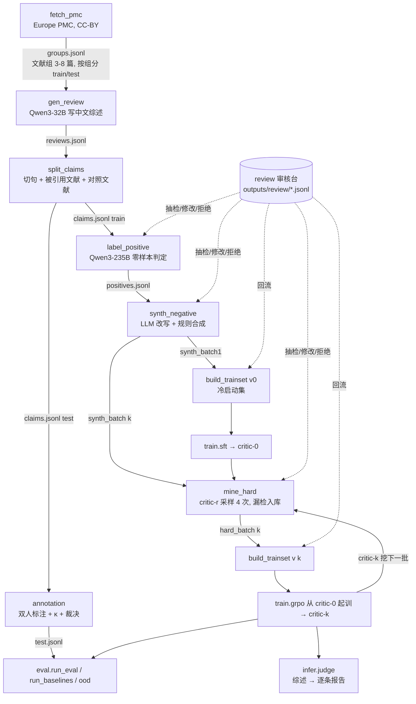

# 数据流程与模块

本文按数据流向梳理整条流水线：每一步读什么、写什么、用哪个模型、靠什么规则保证质量，以及哪些代码被多个阶段共用。
命令清单见 [README](../README.md)，标注规范见 [annotation/guidelines.md](../annotation/guidelines.md)。

## 1. 总览



三个循环：

- **数据循环**（第 2 节）：文献 → 综述 → claim → 正样本 → 负样本，一次性跑完。
- **迭代循环**（第 3 节）：critic-r 挖难样本 → 训练集 v(r+1) → GRPO → critic-(r+1)，共 3 轮。
- **人工循环**（第 5 节）：每一步的产物进审核台，人工结论写进审核记录，组装训练集时回流。

## 2. 样本格式

所有阶段读写 JSONL，一行一条。正负样本、训练集、测试集都是同一个结构（`common/schema.py:Sample`）：

| 字段 | 含义 |
| --- | --- |
| `id` / `split` / `source_group` | 样本 id；train / val / test；文献组 id（按组切分，训练测试不共享文献） |
| `refs` | `{ref-id: 英文原文}`：claim 引用的文献 + 同组最相关的 k 篇对照文献，被引用的排在前面 |
| `cited` | claim 标注引用的 ref id；`[]` 表示句子没有标引用；缺省时视为 refs 全部被引用（OOD 数据） |
| `claim` | 中文 claim，已去掉 `[ref-N]` 标记 |
| `label` / `type` | faithful + none，或 hallucination + 五类之一 |
| `evidence` | `ref-N: "逐字原文"`；引用错误中的无中生有为 `none` |
| `reason` | 一句话原因（hallucination 必填） |
| `origin` / `round` / `parent_id` | positive / synthetic / human；难样本挖掘轮次；负样本派生自哪条正样本 |
| `meta` | 过程信息：合成方法 recipe、强模型思路、改写思路、critic 4 次采样输出、检出率、重写次数、规则合成记录等 |

critic 看到的输入由 `common/prompts.py:sample_input` 从样本渲染，所有阶段共用：

```
[references]
(ref-1) [被引用] In a randomized controlled trial of 412 adults ...
(ref-3) [对照] In a cohort study of 3,100 older adults ...
[glossary]
type 2 diabetes = 2型糖尿病
HbA1c = 糖化血红蛋白
[claim]
在 18 至 65 岁的 2型糖尿病成人患者中，二甲双胍在 24 周内使糖化血红蛋白下降 1.1%。
[cited]
ref-1
```

critic 输出 `<think>…</think><verdict>…</verdict><evidence>…</evidence><type>…</type><reason>…</reason>`。

## 3. 五类错误

| 类型 | 判断问题 | 合成方法（recipe） | evidence | 定位分条件 |
| --- | --- | --- | --- | --- |
| citation_error 引用错误 · 挂载错误 | 内容有出处，但出处是对照文献而不是被引用的那篇 | `swap`，**规则**：claim 不动，引用换成另一篇对照文献 | 真正出处里的原文 | 逐字可定位，且出自**未被引用**的文献 |
| citation_error 引用错误 · 无中生有 | 核心事实在所有给出的文献里都找不到 | `unsourced`，LLM：加一个文献里没有的具体事实 | `none` | 输出 `none` |
| term_error 术语翻译错误 | 英文术语被译成意思不同的另一个中文术语 | `term`，**规则**：按术语词典把标准译名换成误译 | 英文术语所在原句 | 逐字可定位 |
| wrong_attribution 张冠李戴 | 结果安错了组 / 研究 / 药物 | `llm` | 说明错误的原文 | 逐字可定位 |
| unsupported_inference 不合理推理 | 相关写成因果、单研究写成定论 | `llm` | 同上 | 同上 |
| missing_condition 前提缺失 | 丢了人群、剂量、时间等限定 | `llm` | 同上 | 同上 |

- 引用错误的两种情况是同一类、同一个标签，只靠 evidence 区分（`none` 即无中生有，`common/schema.py:is_unsourced`），不另设字段。reward 和定位准确率按**真值**证据判断该写 none 还是引原文，否则模型一律写 none 就能绕开「找出处」。
- 判定顺序（prompt、标注规范、审核台一致）：先查引用（citation_error），再查术语（term_error），最后查内容（wrong_attribution > unsupported_inference > missing_condition），命中第一类即停。
- faithful 的证据必须出自被引用的文献（句子没标引用时任一篇都行）。
- 引用了根本不存在的 ref 编号：推理时规则直接判 citation_error，不送 critic；训练数据里这类句子在 split_claims 阶段就丢掉。

**为什么要对照文献**：只给被引用的文献时，「内容在另一篇」和「哪篇都没有」对 critic 看起来完全一样，挂载错误给不出真正出处的证据。所以每条样本都附 k 篇（默认 2）同组对照文献，正样本也一样，避免「有对照文献 ⇒ 有错」这种捷径。

**为什么要术语词典**（`configs/glossary.tsv`，英文 / 标准译名 / 常见误译）：术语译名对不对，模型靠记忆不可靠，也没法审计。词典在三处用同一份：

1. 合成：term_error 按词典替换，标签零噪声；
2. 输入：critic 输入附上参考文献中出现的词条（只看英文是否在文献里出现，正负样本拿到同样的词条，不泄露答案）；
3. 推理预检：claim 里出现误译且没有标准译名时单列提示。误译若恰好是文献里另一个术语的标准译名（文献同时有 RCT 和 cohort study，claim 写「队列研究」），不报。

## 4. 逐阶段说明

### 4.1 fetch_pmc：文献组

- 命令：`python -m data.fetch_pmc --config configs/data.yaml --with_sections`
- 输出：`outputs/data/groups.jsonl`，每行一个文献组 `{group_id, topic, refs, papers, split}`。
- 规则：Europe PMC 按主题检索，只留 `license == cc by`；每篇取摘要，可选拼上 Results / Conclusion 段（≤ 4000 字符）；同主题随机切成 3–8 篇一组；**按组**划 10% 为 test。

### 4.2 gen_review：中文综述

- 模型：Qwen3-32B（`generator`），每组写 2 版。
- 输出：`outputs/data/reviews.jsonl`。
- 规则：先出大纲再写正文，每句句末标 `[ref-N]`；`language: zh` 时写简体中文，术语译成中文，缩写和药名可保留英文。**不给**生成模型术语词典，让译名错误自然出现。

### 4.3 split_claims：切 claim

- 命令：`python -m data.split_claims --reviews … --out … --context_k 2`
- 输出：`outputs/data/claims.jsonl`，`{id, source_group, split, refs, cited, claim}`。
- 规则：保护缩写和小数点后按句切；句首的引用标记还给上一句；不足 6 个 token 的无引用片段并入上一句；无引用的句子丢弃；引用了不存在编号的句子丢弃。`refs` 由 `common/context.py:select_context` 组装：被引用的在前，再按跨语言线索（数字、英文缩写、词典回译的英文术语）挑 k 篇最相关的对照文献。推理用同一个函数。

### 4.4 label_positive：正样本

- 模型：Qwen3-235B（`judge`），温度 0，用的就是 critic 的 prompt。
- 输出：`outputs/data/positives.jsonl`，抽 5% 到 `outputs/audit/positives_audit.jsonl`。
- 规则：只处理 train 的 claim；判 faithful、格式合规、证据逐字可定位、且证据出自被引用的文献，才算正样本。
- 质量关口：审核台抽检，`judge_wrong` 比例 > 3% 就收紧 prompt 重跑。

### 4.5 synth_negative：合成负样本

- 命令：`python -m data.synth_negative --config configs/data.yaml --batch k`
- 输出：`outputs/data/synth_batch{k}.jsonl`。
- 类型分配：先看每条正样本能用哪些方法（单引用且有对照文献才能 swap；被引用文献里有词典术语、claim 里有其标准译名才能 term），类型挑全局用得最少的，citation_error 内部再在 swap / unsourced 之间轮换；每条正样本派生 2 条。方法记在 `meta.recipe`，难样本重写时沿用。
- LLM 方法的校验：type 一致；证据逐字可定位（unsourced 必须是 none）；与原 claim 的 token 编辑距离在 [1, 40]。
- 规则方法：swap 把引用换成对照文献并把它排到 refs 最前（和正样本的顺序一致，不留位置捷径）；term 的证据取英文术语所在整句。

### 4.6 build_trainset v0 + SFT：critic-0

- `build_trainset --version 0`：正样本 + 第 1 批**未过滤**合成负样本，各 1000 条，各类错误等量 → `outputs/data/coldstart.jsonl`。
- `train.sft --mode coldstart`：think 用一句模板占位，只教格式和五类定义 → `outputs/ckpt/critic-0`。

### 4.7 mine_hard：难样本挖掘

- 命令：`python -m data.mine_hard --config configs/data.yaml --batch k --round r`（critic-r 用 vLLM 起服务）。
- 输出：`outputs/data/hard_batch{k}.jsonl`，抽 200 条到 `outputs/audit/hard_batch{k}_audit.jsonl`。
- 规则：critic 对每条采样 4 次，检出率 < 0.5 视为漏检，入库并记 `round = r+1`、检出率、重写次数和 4 次输出；检出的把 critic 的分析反馈给生成模型重写（规则类型换一个术语 / 换一篇文献），最多 2 次。
- 质量关口：审核台抽检，`not_an_error` 比例 > 10% 就停下来改 prompt。漏检样本里混着「根本不是错误」的样本（如 above 改成 over），这一步只能靠人。

### 4.8 build_trainset v k：训练集

- 输出：`outputs/data/trainset_v{k}/train.jsonl`、`val.jsonl`。
- 规则：读入前先套用审核记录（拒绝的剔除、修改的替换）；负样本按轮次分层，最难一轮 ≤ 40%；各类错误等量（某类缺失时跳过并告警）；正负 1:1；10% 的正样本和无中生有负样本去掉引用标注（`cited=[]`），覆盖推理时没标引用的句子；按文献组切 5% 验证集。

### 4.9 GRPO：critic-k

- `train.grpo prepare`：按 batch 预排序（每个 batch 正负各半、负样本在各类型间轮转），转 verl parquet，ground truth 带 `{label, type, refs, cited, evidence}`。
- `train.grpo launch`：verl GRPO，G=8，KL 0.01，`data.shuffle=False`；每轮都从 critic-0 起训，只换训练集版本。
- reward（`train/reward.py`）：1.0×标签 + 0.3×格式 + 0.3×定位；定位分以标签正确为前提，hallucination 还要 type 对，evidence 规则见第 3 节。
- TRL + LoRA 备选：`train.grpo_trl`，同一个 reward。

### 4.10 测试集标注与评测

- 测试 claim：`claims.jsonl` 里 `split == test` 的行，抽约 1000 条。
- `annotation.ls_io export` → Label Studio 双人独立标注（界面显示被引用 / 对照文献和术语表）→ `import` → `annotation.kappa agree`（κ < 0.6 修订规范重标）→ 裁决 → `merge` 出 `data_release/test.jsonl`。
- `eval.run_eval`：任一 OpenAI 兼容模型，同一个 prompt；指标为 hallucination 类 F1（解析失败按判错算）、各类型召回、定位准确率（真值为无中生有时输出 none 即算对）、格式合规率、F1 的 bootstrap 95% CI。
- `eval.run_baselines`（MiniCheck、RefChecker，只出 verdict）、`eval.ood`（LLM-AggreFact，英文，无类型）。

### 4.11 推理

`python -m infer.judge --input review.json --model critic-3 --out report.md [--context_k 2] [--check_uncited]`

切 claim、选对照文献、附术语表都和训练数据走同一份代码。两条规则兜底：引用了不存在的编号直接判 citation_error；术语预检结果单列一栏，与 critic 判定并排展示，不覆盖 critic。`--check_uncited` 时没标引用的句子也送检。

## 5. 人工审核回路

- 服务：`python -m review.server --config configs/data.yaml --reviewer 名字`，可审 positives、synth_batch{k}、hard_batch{k}、coldstart。
- 每条样本显示：参考文献（被引用 / 对照标注、证据高亮）、与原 claim 的逐词差异和引用变化、术语表与预检命中、生成模型思路、critic 4 次采样、同一原 claim 的派生样本、审核历史。
- 可改字段：claim、cited（勾选参考文献）、label、type、evidence（划选原文；无中生有选 none）、reason。引用错误的样本标题栏标出是「挂载错误」还是「无中生有」。修改实时走与流水线相同的校验（`review/store.py:validate`），校验不过不能存为通过。
- 记录：追加写 `outputs/review/<dataset>.jsonl`，同一 id 以最后一条为准；`base_hash` 记下审核时样本内容，样本被重跑改动后旧修改不套用、提示重审。
- 回流：`build_trainset` 读每个数据集时调用 `review.store.reviewed`。

## 6. 共享模块

一致性靠「同一件事只有一份代码」保证：

| 模块 | 职责 | 使用方 |
| --- | --- | --- |
| `common/schema.py` | 样本结构、五类错误、`cited_ids` / `cited_refs` / `is_unsourced`、JSONL 读写 | 全部 |
| `common/prompts.py` | critic system prompt、输入渲染（被引用 / 对照 / 术语表） | label_positive、synth_negative、mine_hard、sft、grpo、grpo_trl、run_eval、judge |
| `common/output_format.py` | 输出解析与格式校验、证据归一化与定位 | reward、metrics、mine_hard、label_positive、judge、审核台 |
| `common/context.py` | 对照文献选取 | split_claims、judge、demo_data |
| `common/glossary.py` | 术语词典：匹配、误译检测、可替换词条 | prompts、context、synth_negative、judge、审核台、Label Studio 导出 |
| `common/llm.py` | OpenAI 兼容调用、重试、断点续跑 | 所有调模型的阶段 |
| `data/split_claims.py` | 切 claim | 数据构建、judge |
| `train/reward.py` | reward 与 `evidence_ok` | verl、TRL、judge（证据合规列）、Gradio 计算器 |
| `review/store.py` | 审核记录、校验、回流、统计 | 审核台、build_trainset、Gradio 看板 |

## 7. 产物文件

| 路径 | 由谁写 | 谁读 |
| --- | --- | --- |
| `outputs/data/groups.jsonl` | fetch_pmc | gen_review |
| `outputs/data/reviews.jsonl` | gen_review | split_claims |
| `outputs/data/claims.jsonl` | split_claims | label_positive、标注导出 |
| `outputs/data/positives.jsonl`、`outputs/audit/positives_audit.jsonl` | label_positive | synth_negative、mine_hard、build_trainset、审核台 |
| `outputs/data/synth_batch{k}.jsonl` | synth_negative | mine_hard、build_trainset v0、审核台 |
| `outputs/data/hard_batch{k}.jsonl`、`outputs/audit/hard_batch{k}_audit.jsonl` | mine_hard | build_trainset、审核台 |
| `outputs/data/coldstart.jsonl` | build_trainset v0 | sft |
| `outputs/data/trainset_v{k}/{train,val}.jsonl` | build_trainset | grpo、grpo_trl、sft full |
| `outputs/review/<dataset>.jsonl` | 审核台 | build_trainset、Gradio 看板 |
| `outputs/ckpt/critic-0`、`grpo-v{k}` | sft、grpo | vLLM → mine_hard、评测、推理 |
| `data_release/test.jsonl` | annotation.kappa merge | run_eval、run_baselines |
| `outputs/eval/<model>/{predictions.jsonl,metrics.json}` | run_eval、run_baselines | Gradio 看板 |

## 8. 已知限制

- 对照文献按跨语言关键词挑选，内容真正的出处没被选进来时，挂载错误会被当成无中生有（类型仍是 citation_error，只是证据写 none）；k 越大越少见，但输入越长（每篇约 1–1.4k token，默认配置 prompt 上限已调到 6144）。
- 术语预检只覆盖词典收录的词条和误译，词典要随审核持续补充；审核台在 term_error 样本没有命中词典时会提示补词。
- 去引用增强只对正样本和无中生有做，没标引用的句子里如果有内容类错误，训练数据覆盖不到。
