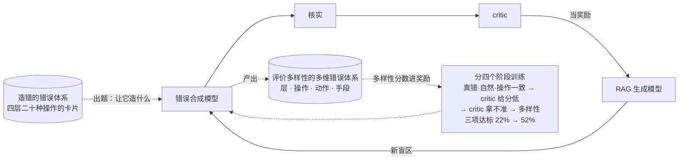

# critic 看不见的地方，就是幻觉藏身的地方

*降低 RAG 幻觉的端到端方案：逐句检测、强化学习与盲区闭环*

这是入口版，只讲目标、结构和结论。论证、数据表和每一步的尝试都在详细版里，文末有导航。

## 目标

**业务目标：** 让 RAG 的回答句句有原文依据。

**核心技术目标：** 跑通一条自己能转下去的循环——

1. 错误合成模型造出 critic 认不出的错（盲区样本）；
2. 把这些样本补给 critic，critic 的盲区变小；
3. 用补过的 critic 当奖励，优化 RAG 生成模型；
4. RAG 模型变好之后，剩下的错又落在 critic 新的盲区里，回到第 1 步。

整个项目要回答的问题是：这条循环在不借助更强模型的前提下，能不能持续把幻觉往下压。

## 结果

**一、幻觉一路降下来。** RAG 回答里含错误的比例（MiniCPM5-2B，三套验收原文上 595 条配对回答，独立的 9B 评测器打分）：

| | RAG-SFT | GRPO 第 1 段 | 第 2 段 | 闭环第 1 圈 | 闭环第 2 圈 |
|---|---|---|---|---|---|
| 含明显错误 | 25.2% | 9.8% | 6.6% | 4.7% | 4.0% |
| 含任意错误（包括细微错） | 35.8% | 21.7% | 16.8% | 10.4% | 9.1% |

循环转了两圈。第一圈的提升显著，而且来自补过盲区的新 critic 而不是多训的步数（有对照组，并独立重跑过）；第二圈仍在降但已不显著。

**二、盲区填充这条路是对的：三组对照。**

| 对照 | 结果 | 说明了什么 |
|---|---|---|
| 2B 整套方案（2B 生成模型 + 2B critic + 两圈盲区填充）对 9B 生成模型 + 9B 奖励模型做一段 GRPO | 含明显错 4.0% 对 3.2%，含任意错 9.1% 对 9.6%，差别不显著 | 生成模型和奖励模型都换大 4 倍能拿到的效果，小模型靠合成盲区样本、补 critic、接着训追平了 |
| 同一个第二段模型接着训：补过盲区的 2B critic 对 9B critic | 含明显错 4.7% 对 5.7%，差别不显著 | 给小 critic 补 558 条盲区样本，不输把奖励模型换大 4 倍 |
| 同一个第二段模型接着训：补过盲区的 2B critic 对奖励模型不换、同样多训 100 步 | 含明显错低 3.2 个点 [−5.3, −1.2]，独立重跑仍然显著 | 提升来自补进去的盲区样本，不是多训的步数 |

另外，9B 直接当 2B 的奖励模型，两个时点都没有带来显著提升：SFT 之后用，含明显错 9.2% 对 9.8%；第二段之后用，相对自己的起点 −1.8 个点 [−4.3, +0.5]。9B 的 critic 离线指标好得多，在第二段模型的输出上能看见 98% 的明显错（2B 各版 74%–80%），但更强的信号没有换来更好的模型。

三组合起来的意思是：决定效果的不是 critic 有多大、离线指标有多高，而是它有没有补上模型当前还在犯、它自己又看不见的那部分错。这正是盲区填充要做的事。

独立第三方的核对：最关键的一组（2B 整套方案对 9B 一段 GRPO）交给和训练链路无关的 Claude 盲判 100 对，明显错打平（7% 对 6%），含任意错 2B 22%、9B 32%。

**三、错误合成模型的合格率翻了一倍多。** 分四个阶段优化之后，真错、自然、操作一致三项都达标的样本从 22% 到 52%，critic 一眼认出的从 55% 降到 33%（见核心手段第 4 条）。

**四、几个和直觉相反的发现本身也是成果。** 它们改变了我们后面怎么做，也是别人最可能踩的坑：离线指标更好的 critic 当奖励不一定更好；换更大的奖励模型没用；训练过的生成器不如只调提示词；奖励“critic 认不出”涨出来的是轻微错；词表规则量不了多样性。逐条见[反直觉的发现](#反直觉的发现)。

**还没做到的：** 第二圈不显著，原因是错误合成跟不上：合格率低、类型和要求对不上、集中在少数几种改法上。之后的工作都集中在这一环，合格率已经抬上来，但“明显错而 critic 认不出”的样本还没有变多（见[现在卡在哪](#现在卡在哪)）。

## 整体结构



| 部分 | 做什么 |
|---|---|
| critic | 2B 小模型，逐句判回答有没有原文依据 |
| RAG 生成模型 | 用 critic 的逐句判断当 GRPO 奖励，惩罚只落在出错的那一句 |
| 错误合成模型 | 在模型自己写的回答上改一句，改成指定的错。最难的一环，分四个阶段训练，每阶段只主攻一个目标 |
| 核实 | 样本进 critic 训练集前由人确认（这里用 Claude 代替） |
| 造错的错误体系 | 四层二十种操作，每种一张卡片，写清做法、适用条件和例子。出题用，回答“让它造什么”。[→ 看二十张卡片](error_cards.md) |
| 评价多样性的多维错误体系 | 一个分类模型，不看出题，从层、操作、动作、手段四个维度判每条样本实际是什么错。量结果用，回答“它实际造了什么”；整批样本的分布和多样性在这套类别上算，再作为多样性分数进奖励 |
| 把关模型 | 小分类器给合成样本打分：真错、自然、操作一致。自然这一项由两个模型分别负责：一个看着原句判改完读着自不自然，一个是判别器，不看原句，判像不像模型自己写出来的错 |

## 核心手段

**1. 句子级奖励的 GRPO。** critic 逐句判有没有原文依据，惩罚只落在出错那一句的 token 上，不是整段一个分。明显错句比整段打分少 43%，不到 SFT 最好结果的一半。 [→ 奖励粒度的对照](tech_share_details.md#奖励粒度表-1) · [→ GRPO 和 SFT 的对照](tech_share_details.md#grpo-和-sft-比)

**2. critic 每升级一次，从上一轮的 RAG 模型接着训。** 每一段换上的 critic 对准的是模型当时还在犯的错，比从头训好。 [→ 分段训练的对照](tech_share_details.md#分段训练表-2)

**3. 盲区闭环加外部核实。** 只把“critic 拿不准、类型对口、经过核实”的样本补给 critic。核实是闭环里唯一的外部信号，不能省：不核实的样本混进约三分之一不是错的，critic 明显变差。 [→ 补什么数据有用](tech_share_details.md#critic-到底需要什么数据表-3) · [→ 不核实的对照](tech_share_details.md#多类型一起补以及能不能省掉核实表-7) · [→ 闭环第一圈的对照和重跑](tech_share_details.md#闭环转了一圈rag-继续变好表-8)

**4. 分阶段优化错误生成模型。** 这是针对“合格样本太少、学不起来”的做法。一条样本要同时满足四个条件，起点模型的产出里全部满足的只有 3% 左右。把四个条件乘在一起当奖励，一组样本往往全是 0 分，没有差异可学。做法是拆成几个阶段：

| 阶段 | 主目标 | 这一阶段新加的 | 前面的目标怎么守 |
|---|---|---|---|
| 一 | 造出干净的真错 | 基础分：真错 × 自然 × 操作一致；critic 已明确认得出的打折 | — |
| 二 | critic 给分低 | 难度项：过了三项门槛的样本，critic 给分越低分越高 | 三项逐项守在进入本阶段时的水平，掉了就给那一项加补偿 |
| 三 | 落在 critic 拿不准的区间 | 难度项换形状：只有 critic 给分在中间一段才有分 | 同上 |
| 四 | 多样性 | 多样性系数：改法重复、套路超常、类别超常的打折；难度项再乘上明显程度 | 同上；难度项权重固定不动 |

每个阶段只多加一项，前面的项原样留着。

每个阶段为什么这样设计：

- **阶段一**只求把“按要求造出真错”练稳。一上来就要求 critic 认不出，只有约 6% 的样本拿得到分，学不动。critic 也不能完全不管：判真错的模型和 critic 很像，只追真错会把样本推向 critic 早就认得出的那类，所以对这类样本打折，但不奖励骗过 critic。
- **阶段二**才开始推难度。难度分只给过了三项门槛的样本，因为最容易骗过 critic 的是根本没错的句子。
- **阶段三**把难度的目标收窄。critic 给分极低的样本多半是它完全不当回事的轻微偏差，真正有用的是它拿不准的那一段。
- **阶段四**针对前三个阶段带出来的副作用：模型把产出集中到了最容易同时拿到三样分数的几招上。这一阶段的主目标是多样性。

第四阶段的多样性由三项折扣组成，合起来最多打到四折：

| 项 | 量的是什么 | 怎么打折 |
|---|---|---|
| 组内重复 | 同一任务的一组样本里，改动几乎相同的 | 相同的 k+1 条，每条乘 1/√(1+k) |
| 节点占比 | 按要求的操作统计“动作 / 手段”节点的占比，和起点模型比 | 超过起点 1.5 倍的部分按比例打折 |
| 类别占比 | 分类模型判的实际操作在全部达标样本里的占比，和出题比 | 超过出题 1.5 倍的类别按比例打折 |

后两项用的是评价多样性的多维错误体系。多样性在这里是折扣，不是加分：它只把重复的样本往下压，不给新颖的样本额外加分，因为给“不一样”加分会鼓励离谱的句子。

第四阶段目前做了第一轮（组内重复），后两项要等多维分类模型训好，是第二轮。

几条做下来才确定的规则：每个阶段只有一个主目标；前一阶段的目标变成后一阶段的约束，逐项守而不是只看综合分；主目标的权重不能因为约束被触发而让步，否则等于被关掉；每个阶段开始前先算有多少任务的组内样本拿得到不同的分，太少就不开训；做不成的任务（原文没有数字却要求改数字）事先筛掉。

最终效果（同一批留出回答上约 5,000 条样本，把关模型和 critic 打分）：

| | 起点 | 分阶段优化后 |
|---|---|---|
| 真错、自然、操作一致三项都达标 | 22% | 52% |
| 达标样本里 critic 一眼认出的 | 55% | 33% |
| 三项达标且 critic 认不出的 | 3.3% | 11.4% |

独立核实确认提升是真的：随机抽查里三项都满足的从约 20% 升到 30%，把关模型判为真错的样本核实同意 91%。 [→ 每个阶段的做法、留出评测和核实抽查](synthesis_issues.md#第五段分阶段强化学习)

奖励函数是这样拼起来的，每一项都对应一个实际踩过的坑：

```
奖励 = [ 基础分 + 难度项 + 像真项 + 补偿项 ] × 多样性系数
```

| 项 | 怎么算 | 为什么这么设计 |
|---|---|---|
| 基础分 | 真错、自然、操作一致三个概率的几何平均；critic 已经明确认得出的样本打折，最多打到五折 | 三项里任何一项低，分数都上不去。打折是因为判真错的模型和 critic 很像，只追“真错”会把样本推向 critic 早就认得出的那一类；但只压明显的一头，不奖励骗过 critic |
| 难度项 | 只给三项都过门槛的样本：critic 给分落在拿不准的区间才有分，再乘上“错得明不明显”的系数；直接加在基础分上，权重固定 | 没过门槛的样本 critic 给分再低也没用，最容易骗过 critic 的是根本没错的句子。用加法而不是乘法，是因为乘在一起时难度分和基础分同涨同落，训练会绕开难度只去抬基础分。权重固定，是因为一让步它就被关掉 |
| 像真项 | 判别器给的“像不像模型自己会犯的错”，只用同一组样本里的排名 | 合成的错和真实的错太容易分开，绝对分数几乎全在低位，直接用会把所有样本压扁；组内排名仍然能告诉模型哪一条更像 |
| 补偿项 | 真错、自然、操作一致哪一项的近期平均掉到进入本阶段时的水平以下，就单独给这一项加权，回到线上再慢慢减 | 推难度时前面几项会被带着往下掉。守约束靠加强掉下去的那一项，而不是削弱主目标 |
| 多样性系数 | 同一任务里改法相同的分摊奖励；某种改法或某一类错的占比超出正常水平就打折；几项合起来最多打到四折 | 不管奖励怎么定，模型都会集中到最容易拿分的几招。只打折不加分，是因为给“不一样”加分会鼓励离谱的句子；设下限，是因为扣得再狠也不该让达标样本的分数掉到没达标的下面 |

**5. 两套错误体系：一套用来造错，一套用来评价多样性。** 造错的体系是四层二十种操作的卡片（[二十张卡片都在这里](error_cards.md)），每张卡片写清做法、适用条件和例子，用来出题。评价多样性的体系是多维的：一个分类模型一次从层、操作、动作、手段四个维度判样本实际是什么错。两套要分开，是因为出题时各种操作是均匀的，但模型常常把要求的操作做成另一种：独立判下来，过了操作一致门槛的样本里只有一半左右确实是要求的操作。按出题统计的分布是假的，只有按实际造出来的东西统计才是真的。评价的体系不依赖出题，所以合成的错、模型自己犯的错、critic 漏掉的错也可以放到同一套类别里比。 [→ 操作清单](synthesis_issues.md#第二段换成面向构造的错误体系) · [→ 多维度分类和多样性](synthesis_issues.md#第六段多样性怎么量怎么保)

**6. 把关模型，自然这一项用两个模型。** 真错、自然、操作一致各有把关模型，都是 2B 单字母分类器，便宜到能给每条采样打分。自然这一项有两个模型同时在用。自然度模型学的是人工标的“读着自不自然”，它看得到改写前的原句，判的是这次改写有没有把句子改坏，负责设门槛。判别器仿照对抗生成里的判别模型，学区分“模型自己写错的句子”和“事后改出来的错句”，不用人工标注，随生成器一起重训，只用它在同一组样本里的相对排名；它不看原句，因为真实的错句没有原句，给了就等于告诉它答案。两个模型输入不同、回答的问题不同，所以不合并：前者抓写坏的句子，后者抓通顺但没有来由的错。 [→ 把关模型的数据和准确率](synthesis_issues.md#第四段重训把关模型) · [→ 判别器](synthesis_issues.md#第五段分阶段强化学习)

## 反直觉的发现

**关于 critic 当奖励**

1. **离线指标更好的 critic，当奖励不一定更好。** 撞见了五次，有时方向相反。训练前能算的指标只能筛掉明显不合格的，排不出名次。 [→ 五个反例](tech_share_details.md#静态指标更好的-critic当奖励不一定更好) · [→ 训练信号的分析](tech_share_details.md#critic-当奖励靠什么起作用一次没押中的分析)
2. **换更大的奖励模型几乎没用，放到训练后期也一样。** 9B 的 critic 离线指标好得多，但换上它训出来没有更好。我们在两个时点各试了一次：

   | 什么时候换成 9B 当奖励 | 2B 奖励 | 9B 奖励 | 差别 |
   |---|---|---|---|
   | SFT 之后直接用（各训 200 步） | 含明显错 9.8% | 9.2% | 不显著 |
   | 第二段之后接着训（各训 100 步） | 4.7%（补过盲区的 2B critic） | 5.7% | 不显著 |

   第一次没拉开差距时，我们猜是前期错多、哪个 critic 都够用，到后期剩下的错更难，9B 的优势才会显现。第二次实验没有支持这个猜想：9B 比旧的 2B critic 好（那两版接着用反而变差），但比不过补了 558 条盲区样本的 2B critic。而在第二段模型自己的输出上，9B 能看见 98% 的明显错，2B 各版只有 74%–80%。信号强这么多，结果却在同一档，说明后期的瓶颈不像是“critic 看不见剩下的错”。给小 critic 针对性地补几百条盲区样本，就拿到了把奖励模型换大 4 倍的效果，而 9B 打分占了每步训练时间的八成多。这个结论的局限：第二段之后用 9B 只训过一次，那个 9B critic 没有补过盲区，“换大”和“补盲区”能不能叠加没有试。 [→ 2B 和 9B 的四种组合](tech_share_details.md#换成-9b小模型加整套方案对上大模型表-10) · [→ 第二段之后换 9B 的对照和训练信号的分析](tech_share_details.md#critic-当奖励靠什么起作用一次没押中的分析)
3. **critic 变不好，不是数据不够，而是不知道它在哪儿看不见。** 随机加几千条合成样本没用，加核实过的真错也没用；只加几百条“critic 拿不准、类型对口、经过核实”的样本才有用。 [→ 五组数据的对照](tech_share_details.md#critic-到底需要什么数据表-3)

**关于错误合成**

4. **让生成器自己挑错误类型，它会挑对 critic 最没用的。** 它偏爱 critic 本来就会判的错，所以类型必须指定。 [→ 数据](tech_share_details.md#让生成器自己挑错误类型它会挑对-critic-最没用的)
5. **知道改了什么，还是判不准是不是错。** 和 critic 同源的把关模型，在 critic 的盲区里一起看不见，定案必须靠外部核实。 [→ 数据](tech_share_details.md#知道改了什么还是判不准是不是错)
6. **训练过的生成器不如只调提示词。** 用真实错误对监督训练，三项都满足的只有 9%；不训练，把操作卡片写进提示词，是 20%。训练数据里“改对的句子”和原来的错句差得太远，生成器学到的是整句重写。 [→ 三种生成器的核实对比](synthesis_issues.md#第三段让生成器照着清单造)
7. **奖励“critic 认不出”，涨出来的是轻微错。** 三个阶段把“达标且 critic 认不出”的样本从 3.3% 推到 11.6%，核实发现其中六成是 `should → may` 这类轻微偏差，明显错只有 18%。回头查，难度分和“错得明不明显”的相关是 −0.41：难度项实际在奖励“错得轻”。 [→ 两次核实抽查和奖励的回查](synthesis_issues.md#第五段分阶段强化学习)
8. **读着自然，不等于像模型自己会犯的错。** 通顺的合成错句，判别器几乎都能和真实错句分开（真实的 93% 判为真，合成的只有一成）。 [→ 判别器的做法](synthesis_issues.md#第五段分阶段强化学习)
9. **词表规则量不了多样性。** 用词表把改法归类，和独立标注对比只有约四分之一是对的：整句改写时，顺带出现的数字和连接词会把规则带偏。 [→ 三把尺子的对比](synthesis_issues.md#第六段多样性怎么量怎么保)

## 最难的一环：错误合成

一条有用的样本要同时满足几件事：是真错、读着自然、是要求的那种错、critic 认不出。难点有四个。

**一、几个目标互相拉扯。** 改得重才确定是错，改得重又不自然；自然的真错 critic 多半认得出，critic 认不出的又多半不是错或者只是轻微的偏差。优化其中一个，另外几个就往下掉。

**二、不是每条回答都适合每一种错。** 原文里没有数字，硬要造数字错，模型只能乱改；没有转述的句子，谈不上去掉转述。给了做不成的任务，一组样本全是 0 分，训练没有东西可学。

**三、模型会偷懒。** 不管奖励怎么定，生成器都会把产出集中到它最有把握拿分的几种改法上：加一个 may，把数字换成 several，把"某人说"换成"有人说"。这类改写又算错、又自然、critic 又不在意，三样都占，但对补 critic 的盲区几乎没用。所以奖励里必须有惩罚重复、鼓励去试别的改法的部分。

**四、多样性很难量。** 要惩罚重复，先得能判断两条样本是不是“同一招”。这件事比看上去难：

- **按用词比**：`should → may` 和 `must → might` 用词不同，会被当成两种改法。
- **按词表规则归类**：把情态词、量词、连接词各列一张表。它只认得有固定词汇标志的改法，换的是实词或语序时认不出；整句改写时还会被顺带出现的词误导。和独立标注对比，规则归的类只有约四分之一是对的。
- **按要求的操作看**：出题时各种操作是均匀的，但模型常常把要求的操作做成另一种，按出题统计出来的分布是假的。

所以多样性要由模型来量：造完之后，用一个分类模型从多个维度判这条样本实际是什么错，再在这套类别上统计分布。

### 主线：合格率一直很低，每一步都在抬它

| 阶段 | 做了什么 | 结果 | 留下的问题 |
|---|---|---|---|
| 最初两圈闭环 | 生成器按 9 个类型造错，前后试过十三种训练方式 | 原始产出里同时满足三个条件的约 2%，每 2,048 条约 40 条，怎么改奖励都不涨 | 类型太粗，生成器只有约三成照做 |
| 换错误体系 | 9 个类型换成四层二十种操作，每种写清做法、适用条件和例子 | 能说清 critic 漏在哪：漏掉的明显错六成在"挂接"层（话安错了人、数字挂错了对象） | 清单有了，生成器还不会照做 |
| 监督训练生成器 | 用真实错误对训练生成器按操作造错 | 失败：三项都满足的只有 9% | 训练数据里的"正确句"是被改回原文措辞的，学到的是整句重写 |
| 只调提示词 | 不训练，把操作卡片直接写进提示词 | 三项都满足的 20%，比训练过的还好 | 上限就在这里，要再涨只能靠强化学习 |
| 重训把关模型 | 用全部核实过的标注重训真错、自然、操作一致三个把关模型 | 三个模型都可用（AUC 0.84–0.91） | 它们是下一步奖励的基础 |
| GRPO 第一阶段 | 奖励 = 真错 × 自然 × 操作一致；对 critic 已经明确认得出的样本扣分 | 三项达标 22% → 35%；核实确认真错、操作一致都在涨 | 不看 critic 时，样本会滑向 critic 早就认得出的那一类 |
| 加判别器 | 在自然度模型之外再训一个判别器，判"像不像模型自己会犯的错"，按组内排名加分 | 三项达标 → 39%，像真实错误的比例 25% → 39% | 合成的错和真实的错仍然很容易分开 |
| 筛掉做不成的任务 | 先普查每个"回答 × 操作"能不能造出达标样本，造不出的不再出题 | 去掉约 17% 一条都造不出来的任务 | — |
| 第二阶段：难度 | 主目标换成"critic 给分低"；前一阶段的三项作为约束，哪一项掉了就单独给它加权 | 三项达标 → 46%；critic 一眼认出的占比 55% → 36% | 难度项的权重一旦让步，就等于被关掉 |
| 第三阶段：拿不准的区间 | 难度只奖励 critic 拿不准的那一段 | 三项达标 → 49% | 核实发现：critic 认不出的样本里六成是轻微错 |
| 第四阶段：多样性（第一轮） | 难度分按"错得明不明显"加权；同一任务里改法相同的样本分摊奖励 | 三项达标 → 52%；重复的改法减少 | critic 漏掉的明显错没有增加；按用词比较抓不住"换个词的同一招" |
| 第四阶段：多样性（第二轮） | 训一个分类模型，一次给出四个维度：哪一层、哪种操作、动作（换值、弱化、模糊化等）、手段（情态词、量词、专名等）；按它判的类别和节点统计分布，占比超出正常水平的扣分 | 进行中 | 分类模型自己要够准；进了奖励之后会不会被钻空子，要靠核实抽查来看 |

三项达标率从 22% 到 52%，critic 一眼认出的样本从 55% 降到 33%。这部分是成功的，核实也确认了。

### 现在卡在哪

- **critic 认不出的样本以轻微错为主。** 抽查这部分样本，明显错约 18%，轻微错约 60%，其余不是错。真正"明显错而 critic 漏掉"的样本，每一版都只占全部产出的 1% 左右，调奖励没有让它变多。
- **最需要的那一层造得最差。** critic 的盲区集中在挂接层，而生成器在这一层造出来的样本，只有不到两成确实是要求的那种操作。
- **偷懒没有根治。** 惩罚组内重复之后，同一个任务里的改法分散了，但"每个任务都用同一招"的情况还在。这要靠上面说的多维度分类来量和罚，正在做。

之后是用产出里筛出的盲区样本去重训 critic、接着训 RAG，验证循环的后半段；同时单独改进挂接层的造法。

## 开源与复现

数据、40 个 LoRA 模型、每个模型的训练配置和复现脚本全部开源（[数据集](https://huggingface.co/datasets/liao11/claim-critic-data)、[模型](https://huggingface.co/liao11/claim-critic-models)）。不需要 GPU 就能重算主要结果表；在全新的 GPU 服务器上只用发布的内容重跑过，结论方向一致。细节见 [RELEASE.md](RELEASE.md)。

## 还没解决的

- 错误合成造不出足够多"明显错而 critic 认不出"的样本（见上一节）。
- 训练前判断不了一个 critic 当奖励有多大用，只能训了才知道。
- 评测器看不准细微错，关键对照只能靠小规模的独立抽查。
- 只在 RAG 问答和摘要上验证过。

## 想看更多

| 想了解 | 看哪里 |
|---|---|
| 错误合成这条线的完整过程：每一步怎么做、数据、失败的原因 | [synthesis_issues.md](synthesis_issues.md) |
| 错误合成的每个结论是用什么实验验证的 | [synthesis_issues.md 的实验一览](synthesis_issues.md#每个结论是怎么验证的) |
| 结果表 1–10、六个结论的论证、闭环的细节、为什么不直接用更大的模型 | [tech_share_details.md](tech_share_details.md) |
| critic 当奖励靠什么起作用的分析、奖励里的护栏、错误体系最初的设计 | [tech_share_details.md](tech_share_details.md) 后半部分 |
| 二十张错误操作卡片的原文和例句 | [error_cards.md](error_cards.md) |
| 奖励函数的完整设计 | [rewards.md](rewards.md) |
| 全部实验，按主题整理 | [experiments.md](experiments.md) |
| 每个模型的训练数据和配置；开源数据与复现 | [MODELS.md](MODELS.md) · [RELEASE.md](RELEASE.md) |
