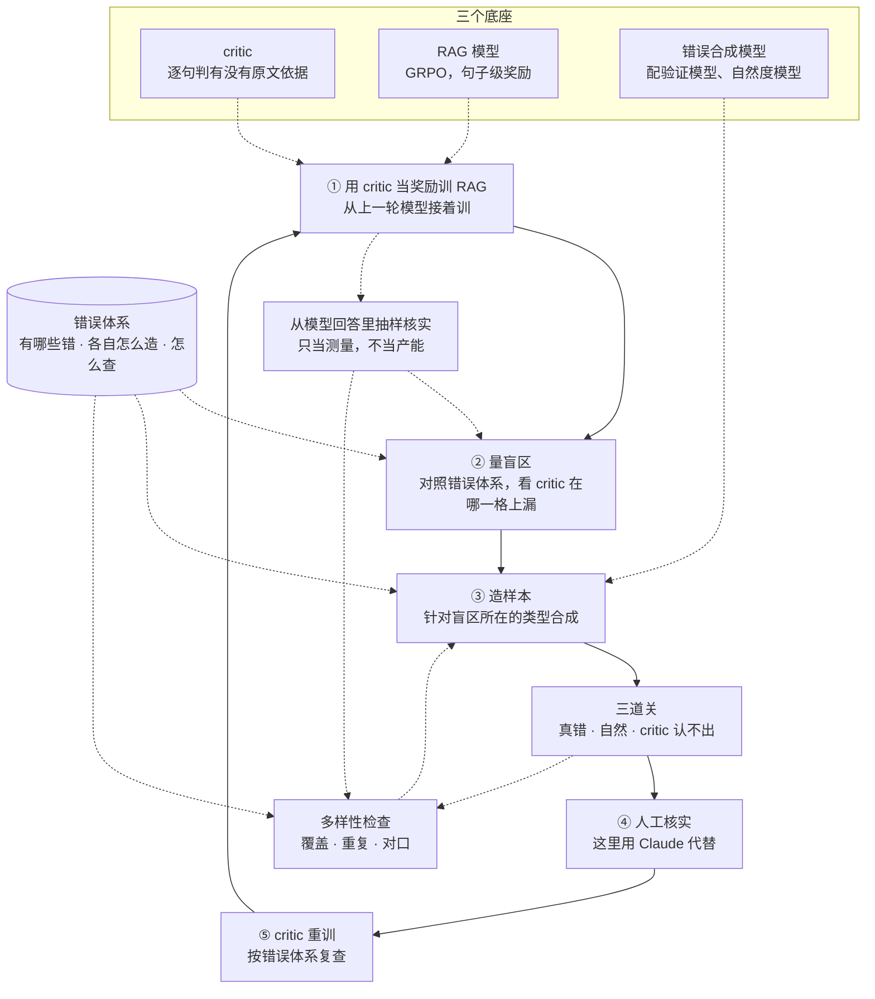

# 技术分享·详细版

这是 [tech_share.md](tech_share.md) 的详细版：完整的表 1–14、每个发现的论证、关键取舍和踩过的坑，以及闭环的细节、奖励里的护栏、critic 当奖励的分析和错误体系的设计。想先快速了解项目，读入口版就够了；错误合成这条线单独写在 [synthesis_issues.md](synthesis_issues.md)。

> 表 1–9 的模型全是 MiniCPM5-2B 加 LoRA，基本都在一张 RTX 5090 上跑；表 10 换成 Qwen3.5-9B 做对照；表 11–14 是整条闭环都换成 9B 后跑的两轮。
> 评测用了两样东西：
> - Qwen3.5-9B 训出来的金标 critic，只用来打分，从不进奖励；
> - Claude 标的金标，我们拿它代替人工。
>
> 文中的区间都是按原文聚类 bootstrap 的 90% 区间。表 1–9 都能用 `python -m scripts.demo_tables` 在没有 GPU 的机器上重新算出来，全部实验的细节在 [experiments.md](experiments.md)，每个模型的训练数据和配置在 [MODELS.md](MODELS.md)。

## 先说结论

做下来最大的收获是一个认知上的转变：**critic 变不好，不是因为数据不够，而是因为我们一直不知道它在哪儿看不见。**

一开始我们和大多数人一样，觉得多造点错误样本喂给 critic 就行。结果造了几千对，没用；连 Claude 确认过是真错的 811 条加进去，也没用。后来才想明白：critic 本来就认得出的错，加多少都是白加。真正有用的，是那些 **critic 拿不准、类型正好落在它盲区、又被人确认过** 的样本。只加了 581 条这样的样本，AUC 就涨了 0.029。

围绕这个认识，我们搭出了一个闭环，并且完整转了两圈：

```
用 critic 当奖励训 RAG ──► 按错误类型看 RAG 犯了什么错、critic 漏了什么
        ▲                                    │
        │                                    ▼
 从上一轮的 RAG 模型接着训          专门针对盲区类型去造难样本
        ▲                                    │
        │                                    ▼
   重训 critic，按类型复查 ◄──────── 人（现在是 Claude）来核实
```

结果分三句话：

- **第一圈明显有效。** 用补过盲区的 critic 接着训 RAG，含明显错误的回答从 6.6% 降到 4.7%，含任意错误（包括细微错）的从 16.8% 降到 10.4%。我们还补了对照：同样多训 100 步、但奖励模型不换。两次独立运行里，新 critic 组的含明显错误都显著低于对照，提升主要来自新 critic，不是步数（含任意错误一次显著、一次临界，见表 8 下的复现）。
- **第二圈收益递减，我们在这里停了下来。** 还在降（4.7% → 4.0%，10.4% → 9.1%），但已经不显著。两圈合起来，任意错从 16.8% 降到 9.1%，主要收益在细微错上。
- **从 SFT 一路下来**，明显错 25.2% → 9.8% → 6.6% → 4.7% → 4.0%，任意错 35.8% → 21.7% → 16.8% → 10.4% → 9.1%。
- **换成 9B 对照**：2B 加整套方案，大幅好于只做 SFT 的 9B（明显错 4.0% vs 15.3%），和 9B 做完第一段 GRPO 的明显错打平；Claude 独立判下来，细微错 2B 还少 10 个点（临界显著）。方法本身在 9B 上同样有效。反过来，2B 起点只把奖励换成更准的 9B critic，并没有比 2B 打分多降（9.2% vs 9.8%，不显著），只是多拒答、写得更短；9B 起点换成 2B 打分，也和 9B 打分打平（3.7% vs 3.2%）（表 10）。
- **整条闭环换成 9B 再转两圈，结果和 2B 一样：第一圈显著，第二圈递减。** 第一圈里，9B 错误合成模型的盲区产出从 3.0% 升到 7.8%；补进 critic 的 1,181 条样本没经过人工筛选。用补过的 critic 接着训，含任意错的回答比同样多训的对照少 3.5 个点（显著）。第二圈里，生成器仍能找到新盲区（产出相对 +38%），但 critic 不再变好，RAG 只有不显著的改善迹象（表 11–14）。

除了闭环本身，这个项目里最值得带走的是下面六个结论。前三个是训练方法上的，后三个和直觉相反，我们认为最值得深挖。

**训练方法上的三个结论**

1. **GRPO 远比 SFT 有效。** 同一批题目上，用 Claude 改对的回答做 SFT，怎么加轮数，每条回答的显然错句也只能降到 0.30 左右；GRPO 训 200 步降到 0.145，不到 SFT 最好结果的一半。用自己的样本挑最好的再 SFT（拒绝采样），幻觉几乎没降（见「GRPO 和 SFT 比」）。
2. **奖励要落到句子上。** 同样的 critic、同样的步数，只是把惩罚只加在出错那一句的 token 上，显然错句就比整段一个分少了 43%（表 1）。
3. **critic 升级后，从上一轮 GRPO 模型接着训，不要从头来。** 同一个新 critic，接着训比从 SFT 重新训少 5.0 个点含显然错（表 2）。

**三个反常识的发现**（见「三个反常识的发现」一节）

4. **静态指标更好的 critic，当奖励不一定更好。** 前后撞见了五次，有时方向完全相反。
5. **让生成器自己挑错误类型，它会挑最容易、但对 critic 最没用的那些。** 所以我们改成指定错误类型，但不指定改哪一句。
6. **知道改了什么，还是判不准是不是错。** sev 看得到原句、改写句和逐词改动，在 critic 的盲区里依然和 critic 一样失明。

两圈之后，我们还得到一个判断：**现有的错误合成方法不足以继续扩充盲区。** 它能补上 critic"拿不准、但能被人确认"的那一层，再往下就挖不动了，后面要靠系统化的错误体系。

## 我们想解决的问题

RAG 回答里最麻烦的幻觉，往往不是整句瞎编，而是一个小地方不对：
- 原文说"有些人"，回答写成"大多数人"；
- 原文说 A 做了某事，回答安到 B 头上；
- 两段里的内容被捏成了一句原文没说过的话。

我们训了一个逐句判断的 critic，看每句话有没有原文依据。它对明显的错判得还行，但对这类细微的错漏得很厉害：Claude 认定的 179 句显然错里，它漏了 99 句；"范围偏移"这一类，它只能召回三成左右。

更麻烦的是，一旦把 critic 当成 RAG 的奖励，RAG 模型会主动往它看不见的地方钻：
- 换上一个更好的 critic 接着训，RAG 开始写更长的句子、更多的列表句，因为 critic 恰好在长句上最弱；
- 奖励模型不换、一直训下去，RAG 会开始合并句子去讨好它。

常见的几种思路，我们基本都试过，也都卡住了：

- **用人工标注训 critic？** RAGTruth 原版的人工标注漏标很多，只用它训出来的 critic 学会了"不敢报错"，9B 认为明显错的句子它只认出 27%。拿它当奖励，RAG 模型干脆什么题都硬答。
- **多造点合成错误？** 生成器最喜欢造的是"加一句空泛评价""加一个原文没有的细节"，这两类恰好是 critic 最擅长判的，在它漏掉的错里只占 1%。从几百对加到 6000 对，一点没涨。
- **找更强的 critic 当奖励？** 静态指标上更好的 critic，RL 训完不一定更好。三档 critic 里，AUC 居中的那档训完 200 步反而最差。

## 几个关键的取舍

回头看，有几个决定是走对了的。每个都有过别的选项，放弃它们也都有实验依据。

**critic 的数据从哪来。** 我们没有用 RAGTruth 的人工标签当主体，而是让 2B 自己写回答，再让 Claude 逐句改对、标注，作为"核心集"。这样标签更干净，错误的分布也和真正要检测的模型一致。纯人工、纯合成我们都单独训过：纯合成的 AUC 显著低一截（−0.034）；纯人工静态指标还行，但当奖励时问题最大。

**奖励要落到句子上。** 最初的奖励是整段回答一个分：第一句错了扣得狠，后面再错几句几乎不多扣；10 句的回答错一句，分数还比 5 句的高。我们先改了整段公式（去掉底噪、按错句计数），几乎没用。真正起作用的，是把负的优势值只加在出错那一句的 token 上，再往前传一点给上一句（表 1）。

**critic 升级后，接着训，别重来。** 每次 critic 变好，都从上一轮 GRPO 模型接着训 100 步，而不是从 SFT 重新训（表 2）。后来专门做了对照并独立复现了一次，确认好处主要来自新 critic，不是多训的步数（表 8）。

**评测别只看一个数。** Claude 标注时，把大多数"范围偏移"归为"细微错"，所以只看显然错的 AUC，专门给范围偏移补的那 0.03 提升就完全看不见。后来固定三个口径一起看：显然错、任意错（包括细微错）、按类型。

**补 critic 的样本，必须经人核实。** 补范围偏移时，不核实的那组只有一半是真错，对目标类型几乎没用（表 4）。多类型一起补时，不核实组的明显错 AUC 比核实组低 0.020，还拖累了直接矛盾等别的类型（表 7）。

**造错的奖励：要难，但不能"越骗过 critic 越好"。** 这条交了很多学费，"踩过的坑"会细说。最后的形式是：先过两道门槛（是真错、读着自然），再按 critic 的分数给难度分，0.3–0.5 之间最高，0.9 以上（critic 一眼能看出的）给 0。

**造出来的样本怎么验。** 起初用另一个 2B 模型（sev）判"这是不是真错"，要求 ≥ 0.9 才放行。后来发现，critic 看不见的地方，sev 也基本看不见。于是改成 sev ≥ 0.5 就进候选、按分数排序，最后交给人核实。

**生成器用 2B 就够了。** 换过 9B，它写的解释好很多，但造出真错的比例一样，都有三分之一以上其实没造出错。

**想要多样性，就多换问答对，而不是对同一个提示多采几次。** 现在是 RAG 模型对每个原文用高温采 8 个不同的回答，生成器对每个（回答，错误类型）只用温度 0 采一次。难样本率从 0.54% 翻到了 1.16%，每条都来自不同的问答对。

## 实验结果

### 奖励粒度（表 1）

R0 到 R3 各训 50 步，在 200 条配对回答上用 9B 金标打分（p ≥ 0.9 算显然错）：

| 奖励 | 含显然错的回答 | 平均每条的显然错句 | 拒答 | 显然错句数比 R0 |
|---|---|---|---|---|
| 训练前 | 36.5% | 0.650 | 26.5% | |
| R0：整段一个分 | 30.0% | 0.485 | 10.0% | — |
| R1：整段，去底噪 + 按错句计数 | 32.5% | 0.445 | 8.5% | −0.040 [−0.117, +0.031] |
| R2：加上句子层优势 | 24.0% | 0.340 | 10.5% | −0.145 [−0.236, −0.061] |
| R3：再往前传一句 | **23.0%** | **0.275** | 9.0% | **−0.210 [−0.309, −0.120]** |

R1 和 R0 几乎没差别，R2 一下子拉开了。关键不在公式怎么写，而在信号有没有落到具体那一句上。

### 分段训练（表 2）

RAG 模型一路训过来的几个版本，在 595 条配对回答上的表现：

| 模型 | 含显然错 | 显然错句 / 条 | 含任意错 | 拒答 |
|---|---|---|---|---|
| RAG-SFT | 25.2% | 0.358 | 35.8% | 27.6% |
| RAG-S1 第 1 段（critic rm1__core，200 步） | 9.8% | 0.106 | 21.7% | 6.0% |
| 对照：新 critic r1，从 SFT 重新训 200 步 | 11.6% | 0.128 | 21.3% | 5.9% |
| **RAG-S2 第 2 段：新 critic r1，从 S1 接着训 100 步** | **6.6%** | **0.072** | 16.8% | 3.5% |
| RAG-S3-r2：再换 critic r2，接着训 100 步 | 8.1% | 0.081 | 14.6% | 1.5% |
| RAG-S3-r3：再换 critic r3（长句增强），接着训 100 步 | 5.4% | 0.056 | 14.0% | 2.2% |

同样用新 critic r1，接着训比重新训少了 5.0 个点含显然错（[−7.6, −2.3]）。

RAG-S3-r2 那一行是个反面教材：critic 更好了，RAG 却没变好，因为它钻进了 r2 的长句盲区。r3 专门补了长句之后才降下来。

### GRPO 和 SFT 比

在全 2B 阶段，我们拿同一批 831 个训练题目，比了三种做法。9B 金标打分，三套验收原文上约 595 条配对回答：

| 做法 | 每条显然错句 | 含显然错 | 含任意错 | 拒答 |
|---|---|---|---|---|
| 起点（未训练） | 0.724 | 40.5% | 47.2% | 36.5% |
| SFT：Claude 只改错句，用改对的回答训 2 轮 | 0.345 | 25.4% | 37.7% | 16.5% |
| 拒绝采样 SFT：每题采 16 条，按奖励挑最好的再 SFT | 0.701 | 40.7% | 49.6% | 24.2% |
| GRPO 50 步 | 0.385 | 27.9% | 39.5% | 23.0% |
| **GRPO 200 步** | **0.145** | **13.3%** | **26.1%** | **9.1%** |

三件事：
- **SFT 有天花板，而且很低。** 把 SFT 加到 3 轮、4 轮，显然错句只到 0.305、0.303，6 轮反而升到 0.407（过拟合）。可训练目标本身（Claude 改对的回答）只有 0.099 句 / 条。数据已经足够干净，模型就是学不到，瓶颈在学习方式。
- **GRPO 200 步不到 SFT 最好结果的一半**，拒答也低得多。一次"Claude 改对再 SFT"大约相当于 GRPO 训 50 步，之后 GRPO 还能一直往下走。
- **拒绝采样 SFT 几乎没降幻觉**（−0.024 [−0.078, +0.030]），只是把拒答降了下来。我们的理解是：挑出来的"最好"主要赢在不拒答、满意度高；而且用自己的样本做一次 SFT，分布基本不动，模型从来没见过"这句错了"的负信号。GRPO 的价值恰恰在这里：同一道题的 16 条回答互相比较，错在哪一句就罚哪一句。

数据：[experiments.md §7.5](experiments.md)；代码：`ragtruth/policy_sft.py`、`scripts/remote/run_s1.sh`、`run_s2.sh`、`run_sftcap.sh`。

### critic 到底需要什么数据（表 3）

这张表是整个项目的转折点：

| 底座 | 加了什么 | 显然错 AUC | 相对底座 | 误报 10% 时的召回 |
|---|---|---|---|---|
| ref（6330 条） | — | 0.821 | — | 0.48 |
| ref | 生成器样本 554 对 | 0.852 | +0.031 [+0.012, +0.049] | 0.61 |
| ref | 生成器样本 1500 对 | 0.840 | +0.019 [+0.002, +0.036] | 0.55 |
| ref | 生成器样本 6000 对 | 0.820 | −0.001 [−0.025, +0.023] | 0.51 |
| — | 只用人工标注（3030 条） | 0.804 | −0.018 [−0.044, +0.009] | 0.51 |
| — | 只用合成数据（3030 条） | 0.787 | −0.034 [−0.063, −0.006] | 0.41 |
| 核心集（4604 条） | — | 0.843 | — | 0.58 |
| 核心集 | 9B 生成器样本，随机 733 | 0.842 | −0.001 [−0.015, +0.011] | 0.56 |
| 核心集 | 9B 生成器样本，Claude 确认是真错的 811 | 0.833 | −0.010 [−0.025, +0.004] | 0.58 |
| 核心集 | **critic 拿不准、且 Claude 确认是真错的 581** | **0.872** | **+0.029 [+0.015, +0.044]** | **0.66** |

最后三行放在一起看：随机加，没用；只挑真错加，还是没用；挑 critic 拿不准的真错加，才有用。

### 定向补一个类型（表 4）

既然知道了 critic 在哪儿弱，我们挑了最弱的"范围偏移"，专门补了 285 条，看各口径 AUC 的变化：

| | 显然错 | 任意错 | 范围偏移 | 直接矛盾 | 张冠李戴 | 近义偏移 |
|---|---|---|---|---|---|---|
| r2 本身的 AUC | 0.872 | 0.808 | 0.731 | 0.871 | 0.847 | 0.758 |
| 补 285 条，Claude 核实过 | −0.014 | +0.002 | **+0.030** [+0.010, +0.052] | −0.021 | −0.018 | −0.001 |
| 补 285 条，没核实 | −0.012 | +0.002 | +0.007 [−0.010, +0.028] | −0.024 | −0.018 | +0.016 |
| 补 285 条，核实过，不配原句 | −0.013 | +0.005 | +0.024 [+0.008, +0.042] | −0.016 | −0.014 | +0.018 |

两个发现：
1. 定向补确实管用，而且只有核实过的才管用；
2. 只补一个类型，会把别的类型带歪一点（明显错整体掉约 0.013），所以下一步要多个类型一起补（表 7）。

### 造难样本：前后试过的十三种做法

第三个难点不是一句话能说清的，我们在这上面花的时间最多。下面按时间顺序列出主要的尝试，每一种都解决了上一种的某个问题，又撞上新的问题：

| # | 做法 | 结果 | 卡在哪 |
|---|---|---|---|
| 1 | 指定 13 种改法让大模型改写，35B 判"是不是真错" | 有效率 31%，有效样本里难样本 5.3% | 判"是不是真错"本身就难：35B 判正确的约三成其实有问题 |
| 2 | 判别器区分真实错误和合成错误，用 DPO 做 GAN 式循环 | DPO 偏好准确率 0.58，几乎没学到；第 2 轮 critic 没有提升 | 生成器起点不在真实分布上，难样本只有 4.4% |
| 3 | 用真实错误做 SFT，再放开让生成器自由选句子、类型和改法 | 自然度 8.9% → 39.7%，难样本 12% | 更自然了，但难样本仍然很少 |
| 4 | DPO：把有效、难、自然加权成一个分数配对 | 循环内"有效且难"翻倍（42 → 84 条），金标上 critic 召回反而更低（0.269 vs 0.305） | 学会了在句尾挂个短语这种好造、却对 critic 没用的错 |
| 5 | 按格子分层的种子生成器 + RM 打分 DPO | 第一轮类型塌缩，矛盾类几乎消失；第二轮按类型配对后合格 64%、难样本 13% | 多目标下，模型专挑打分模型最容易满足的类型 |
| 6 | 9B 生成器 GRPO：难度 + 自然 + 多样性 | 改法名从 18 种涨到 71 种；"又难又被 Claude 认可"只有 12–14% | 自己填的字段被钻空子 |
| 7 | 2B 定向生成器 GRPO，三版不同种子 | 骗过 critic 的比例全部下降（如 19.2% → 6.2%） | GRPO 一直把生成器推向明显的错 |
| 8 | 奖励形状对比 a0–a12，十余版 | 目标区间的真错数一直在 98–106 条 | 改形状只改变纯度，不改变产量 |
| 9 | sev 门槛 + (1 − critic 分数) × 自然度 | "盲区里的真错"产量停在 1.39% | 三个分数同时高的样本太少，组内拉不开 |
| 10 | 直接奖励骗过 critic（gated / add） | 造出的"错误"只有 24% 是真错 | 最容易骗过 critic 的，是根本没错的句子 |
| 11 | 改为指定 9 类之一，sev 当主奖励 | 真合格产出约 ×5，但大多是 critic 已能判出的 | 加上 critic 区间门槛后几乎没有正样本 |
| 12 | critic 难度当主奖励（三角、保底、只奖励 < 0.7、组内排名） | 有保底就往明显错跑（55% → 72%）；去掉保底 50 步几乎不动 | 64 组提示里 42 组全是 0 分，GRPO 没有梯度 |
| 13 | 改成"大量采样 → 挑难样本 → SFT"迭代，配合大提示池 | 过门槛样本的 critic 分布一路下移，但难样本卡在每 2048 条约 40 条 | 不少合格的难样本倒在 sev 门槛上：验证模型和 critic 一起失明 |

把这十三次放在一起看，瓶颈始终是同一个：**"是真错、读着自然、critic 拿不准"这三个目标互相拉扯，同时满足的样本太稀疏。** 换模型、换偏好学习方法、换奖励形状，都只是在纯度和产量之间挪来挪去。指定错误类型（第 11 步起）让情况好了一些，但 9 个粗类仍然太宽：同一类里各种改法的难度和适用的句子差别很大。这是我们认为下一步必须把错误体系细化到子类、只在合适的句子上出题的原因。

### 造难样本：进步了，但卡住了（表 5、表 6）

错误生成器迭代了四轮，每一版都在同样的 64 个留出提示上各采 32 条：

| 生成器 | 过门槛的 | 其中 critic < 0.5 | 其中 critic ≥ 0.9 | 过门槛且 critic 在 0.1–0.5 | critic 拿不准且自然的（不管门槛） |
|---|---|---|---|---|---|
| SFT 起点 | 28.0% | 5.6% | 55.5% | 29 | 552 |
| 第一轮难样本 SFT | 32.4% | 6.0% | 50.5% | 36 | 572 |
| 第二轮 | 27.9% | 7.3% | 48.6% | 37 | 630 |
| 再加 50 步 GRPO | 31.9% | 7.2% | 45.3% | 42 | 598 |
| 大提示池上的难样本 SFT | 25.6% | 8.8% | 43.0% | 39 | 704 |

（"过门槛"是 sev 判有错 ≥ 0.9 且自然度 ≥ 0.5；后两列是 2048 条里的条数。）

前四列看起来很让人沮丧：明显错的比例从 55% 降到了 43%，但真正能用的难样本一直卡在 40 条上下。看最后一列才明白，生成器每轮都能造出五六百条 critic 拿不准、读着也自然的句子，大部分倒在了 sev ≥ 0.9 这道门槛上。

于是我们把门槛放到 0.5，每种类型随机抽 10 条，请 Claude 看看到底是什么情况：

| 要求造的类型 | 抽了 | 真错 | 其中显然错 | 实际类型对得上 | 真错且自然 |
|---|---|---|---|---|---|
| 近义偏移 | 9 | 9 | 1 | 4 | 9 |
| 张冠李戴 | 10 | 8 | 2 | 4 | 8 |
| 添加事实 | 10 | 7 | 1 | 2 | 6 |
| 范围偏移 | 9 | 6 | 1 | 2 | 5 |
| 数字日期 | 10 | 6 | 2 | 3 | 4 |
| 直接矛盾 | 10 | 6 | 2 | 3 | 5 |
| 跨段拼接 | 10 | 6 | 2 | 4 | 5 |
| 无依据推断 | 10 | 5 | 1 | 2 | 5 |
| 附加评价 | 10 | 5 | 2 | 3 | 4 |

三分之二是真错，而且集中在 critic 最弱的几类。sev 的分数依然有参考价值：0.5–0.8 之间真错率 61%，0.8–0.9 是 75%，0.9 以上 79%。

所以，**模型是能造出 critic 盲区样本的，只是我们之前用一个和 critic 一样"瞎"的模型去验，把它们都挡掉了。**

### 多类型一起补，以及能不能省掉核实（表 7）

第一轮正式补盲时，范围偏移和跨段拼接各取 300 条、近义偏移和张冠李戴各取 100 条，全部交 Claude 核实，按真错率决定留哪些：
- 范围偏移按 sev 取最高的那批，93% 是真错；
- 跨段拼接、近义偏移、张冠李戴都在 64–69% 左右。

近义偏移和张冠李戴之前抽查时看着像"不用核实"，所以专门做了一组对照：一组只放核实过的（cl），一组从同一批里随机取同样条数、不看 Claude（nc）。

| 口径 | r2 的 AUC | 核实组 cl | 不核实组 nc | cl − nc |
|---|---|---|---|---|
| 显然错 | 0.872 | −0.012 [−0.028, +0.004] | −0.032 [−0.050, −0.016] | **+0.020 [+0.008, +0.034]** |
| 任意错 | 0.808 | +0.005 [−0.005, +0.015] | −0.006 [−0.017, +0.005] | **+0.010 [+0.003, +0.019]** |
| 范围偏移 | 0.731 | +0.015 [−0.004, +0.035] | +0.015 [−0.004, +0.034] | +0.001 |
| 近义偏移 | 0.758 | +0.004 | +0.005 | −0.000 |
| 张冠李戴 | 0.847 | −0.004 | −0.017 [−0.034, −0.002] | +0.013 |
| 跨段拼接 | 0.871 | −0.011 | +0.007 | −0.019 |
| 直接矛盾 | 0.871 | +0.001 | −0.040 [−0.072, −0.010] | **+0.041 [+0.018, +0.066]** |

两点结论：
1. **核实省不掉。** 不核实组里大约三分之一不是错，伤的不只是这两类，明显错整体和直接矛盾都显著下降。之前每类只抽 10 条看到的"九成是真错"，是样本太少的假象。
2. **对目标类型的提升很有限。** 范围偏移 +0.015，不显著；近义偏移、张冠李戴基本没动。好处是不再像只补一类那样拖累整体。

这时 critic 的静态指标几乎没变。我们一度以为第一轮白做了，直到用它去训 RAG。

### 闭环转了一圈：RAG 继续变好（表 8）

用核实组 critic（下面叫 bfcl）从 RAG-S2 接着训 100 步，得到 RAG-S3-bf。595 条配对回答：

| RAG 模型 | 含明显错 | 明显错句 / 条 | 含任意错 | 拒答 | 句数 |
|---|---|---|---|---|---|
| RAG-SFT | 25.2% | 0.358 | 35.8% | 27.6% | 3.83 |
| RAG-S1（第 1 段） | 9.8% | 0.106 | 21.7% | 6.0% | 3.81 |
| RAG-S2（第 2 段） | 6.6% | 0.072 | 16.8% | 3.5% | 3.74 |
| RAG-S3-r2 | 8.1% | 0.081 | 14.6% | 1.5% | 3.47 |
| RAG-S3-r3 | 5.4% | 0.056 | 14.0% | 2.2% | 3.74 |
| **RAG-S3-bf（第 3 段，补过盲区的 critic）** | **4.7%** | **0.047** | **10.4%** | 1.8% | 3.72 |
| 对照 RAG-S3-r1（从 S2 出发、奖励模型不换、同样 100 步） | 7.9% | 0.082 | 14.4% | 2.2% | 3.44 |

- 和自己的起点比（RAG-S2 同一次重新生成），三项都显著下降：含明显错 −2.9 [−5.5, −0.5]，明显错句 −0.035 [−0.064, −0.010]，含任意错 −4.7 [−7.8, −1.9]。
- **会不会只是因为多训了 100 步？** 对照组 RAG-S3-r1 和自己的起点比没有改善，句数反而从 3.72 掉到 3.44，开始合并句子去讨好已经被摸透的旧 critic。同样多训 100 步，S3-bf 比它少 3.2 个点含明显错 [−5.3, −1.2]、少 4.0 个点含任意错 [−6.6, −1.5]。
- **独立复现。** 开源时我们在一台新的 GPU 服务器上，只用发布的数据、LoRA 和复现脚本（`scripts/repro/r2_rag.sh`），从 RAG-S2 重新训了这两组：

  | | 原实验 | 复现 |
  |---|---|---|
  | 新 critic 组：含明显错 / 含任意错 | 4.7% / 10.4% | 3.9% / 11.6% |
  | 对照组：含明显错 / 含任意错 | 7.9% / 14.4% | 5.9% / 13.9% |
  | 新 critic − 对照：含明显错 | −3.2 [−5.3, −1.2] | −2.0 [−3.6, −0.5] |
  | 新 critic − 对照：含任意错 | −4.0 [−6.6, −1.5] | −2.4 [−4.7, +0.0] |

  新 critic 组复现得很好；变化主要在对照组，这次它自己也降了 2 个点。所以结论要说得更谨慎：**含明显错上两次都显著，提升主要来自新 critic；含任意错上一次显著、一次临界。** 原实验里对照组"完全没改善"有一部分是那一次运行的随机性，同一设置重跑能差约 2 个点，这也是没做多种子重复的代价（`results/repro_r2_report.txt`）。
- 句数、长度都没变，没有钻空子的迹象。

critic 的静态指标几乎没变，当奖励却明显有效，我们的理解是：补了盲区之后，critic 对细微错"有了感觉"。范围偏移里完全看不见（P < 0.1）的从 25% 降到 17–19%，分数哪怕没过 0.5，在 GRPO 的组内比较里也会变成梯度。

### 第二圈：收益递减（表 9）

第二圈改了两处：
- 样本来自新 RAG 模型（S3-bf）的回答；
- 选样时一半取 sev 0.5–0.9 的难段，第一圈太偏向"好认"的样本了。

9 种类型一共交 Claude 核实了 1481 条，留下 799 条真错且自然的，补成第二轮 critic（rd2），再从 S3-bf 接着训 100 步：

| RAG 模型 | 含明显错 | 明显错句 / 条 | 含任意错 | 句数 |
|---|---|---|---|---|
| RAG-S2 | 6.6% | 0.072 | 16.8% | 3.74 |
| RAG-S3-bf（第一圈） | 4.7% | 0.047 | 10.4% | 3.72 |
| S4 起点（S3-bf 重新生成） | 4.5% | 0.049 | 9.8% | 3.75 |
| **RAG-S4-rd2（第二圈）** | **4.0%** | **0.040** | **9.1%** | **4.19** |

- 和自己的起点比：含明显错 −0.5 [−1.9, +0.9]，含任意错 −0.7 [−3.0, +1.6]。还在降，但不显著。
- 句数从 3.75 涨到 4.19，长度不变，开始把句子拆短。好在 9B 没看到错误随之上升。
- 第二轮 critic 的静态区分度本身也不升反降：任意错 AUC −0.019 [−0.030, −0.008]，范围偏移 −0.025。正确句子里 P < 0.1 的从 54% 降到 40%，它学成了"更多疑"，而不是"更准"。

原因不难理解：难段里一半是真错，而且几乎都是和忠实改写只差一点的细微错。补进去以后，critic 学到的是"对这种改写形态都怀疑一点"。

两圈合起来，含任意错从 16.8% 降到 9.1%（−7.7 个点 [−11.0, −4.8]），降幅是明显错的三倍，主要收益在细微错上，这和补进去的样本以细微错为主是对得上的。但第二圈已经明显收益递减，我们决定闭环到此为止。

### 换成 9B：小模型加整套方案，对上大模型（表 10）

前面所有结论都是在 MiniCPM5-2B 上得到的。为了看清楚方法本身离不离得开模型大小、以及小模型加整套方案离大模型还有多远，我们把基座换成 Qwen3.5-9B，同样的数据、同样的流程、同样的超参，从头训了一遍：critic、满意度模型、拒答模型、RAG SFT 全部换成 9B 版，再用 9B critic 当奖励做 GRPO（相当于 2B 的第一段，200 步）。

先看 critic 本身。同一份训练数据、同一批 Claude 金标（2,061 句，显然错 179 句）：

| | 2B critic | 9B critic | 差值 [90% 区间] |
|---|---|---|---|
| 显然错 AUC | 0.843 | 0.948 | +0.105 [+0.084, +0.129] |
| 显然错，误报 10% 时的召回 | 0.58 | 0.84 | +0.27 |
| 任意错 AUC | 0.800 | 0.877 | +0.076 [+0.059, +0.094] |

六个错误类型 9B 都显著更好，提升最大的是直接矛盾（0.842 → 0.956），最难的范围偏移也从 0.721 升到 0.793，但仍是最弱的一类。训练数据和测试集没有原文重叠。

再看 RAG。三套验收原文上 595 条配对回答，9B 评测器打分：

| 模型 | 含明显错 | 明显错句 / 条 | 含任意错 | 拒答 | 字数 |
|---|---|---|---|---|---|
| 2B 未训练 | 38.5% | 0.719 | 47.4% | 36.1% | 391 |
| 9B 未训练 | 52.3% | 0.879 | 71.8% | 3.0% | 654 |
| 2B SFT | 25.2% | 0.358 | 35.8% | 27.6% | 431 |
| 9B SFT | 15.3% | 0.171 | 29.6% | 1.0% | 507 |
| 2B GRPO 第一段（RAG-S1，200 步） | 9.8% | 0.106 | 21.7% | 6.0% | 498 |
| 2B SFT + 9B 打分模型，GRPO 200 步 | 9.2% | 0.109 | 19.3% | 8.9% | 453 |
| 9B GRPO 100 步 | 3.0% | 0.030 | 9.6% | 0.5% | 507 |
| 9B GRPO 200 步 | 3.2% | 0.032 | 9.6% | 0.3% | 510 |
| 9B SFT + 2B 打分模型，GRPO 200 步 | 3.7% | 0.040 | 10.1% | 0.2% | 533 |
| **2B 整套方案（两圈闭环后）** | **4.0%** | **0.040** | **9.1%** | 1.3% | 506 |

几个配对差值（90% 区间）：
- 2B 整套方案 − 9B SFT：含明显错 −11.3 [−14.2, −8.3]，含任意错 −20.5 [−24.3, −16.8]，拒答持平。
- 2B 整套方案 − 9B GRPO 200 步：含明显错 +1.0 [−1.0, +2.9]，含任意错 −0.3 [−3.2, +2.7]，打平。
- 9B GRPO 100 步 → 200 步：几乎没变，后 100 步没有再降。

这张表有个问题：评测器本身就是 9B 模型，而 9B 策略是拿同底座、同源数据训出来的 9B critic 当奖励训的。我们担心评测器和奖励模型会一起看不见同一类错。所以 9B GRPO 那一行，我们又请 Claude 独立判了一次：两组各 100 条配对回答（91 个原文），盲标，每次调用 10 条，同一批里原文互不相同、两组各半：

| | 含明显错（Claude） | 含任意错（Claude） | 含明显错（9B 评测器） | 含任意错（9B 评测器） |
|---|---|---|---|---|
| 2B 整套方案 | 7% | 22% | 3% | 8% |
| 9B GRPO 200 步 | 6% | 32% | 2% | 11% |
| 9B − 2B [90% 区间] | −1 [−7, +5] | **+10 [0, +20]** | −1 [−4, +2] | +3 [−4, +9] |

- **明显错，两者打平**，Claude 和 9B 评测器一致。
- **任意错（包括细微错），Claude 认为 2B 整套方案更少**，少 10 个点，区间下沿刚好碰到 0，100 对的样本下是临界显著。
- **9B 评测器在 9B 策略的输出上更不可靠**：和 Claude 的一致性 κ 只有 0.14，在 2B 的输出上是 0.32。它报的"含任意错"只有 Claude 的三分之一左右。我们起初把它归因于评测器和奖励模型同源；后面把奖励换成 2B 打分后，一致性同样低，所以不只是同源的问题。

表里还有一组用来回答另一个问题："更准的 critic 当奖励，能给 2B 多降多少？"做法是 2B SFT 起点、奖励换成 9B 的 critic / 满意度 / 拒答模型，其余和 RAG-S1 完全一样，训 200 步。

结果是**没有多降**：
- 和 RAG-S1 比：含明显错 9.2% vs 9.8%（−0.5 [−2.9, +1.9]），含任意错 19.3% vs 21.7%（−2.4 [−5.5, +0.9]），都不显著。
- 拒答反而多了 2.9 个点 [+1.7, +4.1]，主要在问答题上（18.1% vs 12.3%）；回答也短了约 45 字。
- 和 2B 整套方案比，含明显错还高 5.2 个点 [+2.8, +7.7]。

而且这个口径还对它有利：评测器和它的奖励模型都是 9B、数据同源。

训练曲线能看出原因：
- 9B 判得更严。被奖励 critic 判为有错的回答，RAG-S1 从 58% 降到 18%，这组从 61% 降到 30% 左右就不动了。
- 奖励第 50 步后一直停在 0.60–0.63，RAG-S1 则升到 0.75。

更准的奖励为什么没有帮上 2B，现在还没有定论。它不是 2B 的能力上限：2B 分段训完是 4.0%，远低于这里的 9.2%。更可能是一步到位太难，或者 9B 多看见的那些错不是 2B 当时的主要问题，这两种解释还在验证。

我们还补了 2×2 的最后一格：**9B SFT 起点，奖励换成 2B 的 critic / 满意度 / 拒答模型**，其余和 9B GRPO 完全一样，训 200 步。

- 含明显错 3.7%，含任意错 10.1%，拒答 0.2%；和 9B 打分的 9B GRPO 比：含明显错 +0.5 [−1.2, +2.0]，含任意错 +0.5 [−2.0, +2.8]，都不显著。句数少了 0.39 [−0.47, −0.29]，字数多 24。
- Claude 对 100 对回答（90 个原文）盲判：明显错 6% vs 5%，打平；含任意错 2B 打分组 22%、9B 打分组 30%，−8 [−17, +1]，临界。
- 这 100 对上，9B 评测器的"含任意错"和 Claude 的一致性两组都低（κ：9B 打分组 0.29，2B 打分组 0.10）。也就是说，评测器在 9B 策略输出上看不准细微错，不只发生在奖励和它同源的那一组。

四格放在一起（含明显错，9B 评测器）：

| | 2B 打分 | 9B 打分 |
|---|---|---|
| 2B 策略（SFT 起点，200 步） | 9.8% | 9.2% |
| 9B 策略（SFT 起点，200 步） | 3.7% | 3.2% |

只训一段时，策略从 2B 换成 9B 少约 6 个点（两行都显著），打分模型从 2B 换成 9B 只差约 0.5 个点（两列都不显著）。2B 整套方案（4.0%）和 9B 的两格都打平：对 9B 打分那格 +1.0 [−1.0, +2.9]，对 2B 打分那格 +0.3 [−1.6, +2.0]。

能说的结论：
1. **方法换到 9B 上同样有效，而且见效更快**：9B SFT 到 GRPO 100 步，含明显错从 15.3% 降到 3.0%。
2. **2B 加整套方案，至少追平 9B 加第一段 GRPO**：明显错打平，细微错 Claude 口径下 2B 还少 10 个点；对只做 SFT 的 9B 则是大幅领先。对要本地部署的小模型来说，这是最有用的一条：只训一段时大模型明显更好，但小模型靠分段训练和闭环能追上来。
3. **模型大不等于幻觉少**：未训练时，9B 几乎全答、写得长，含明显错 52.3%，比 2B 的 38.5% 还高（2B 有三成多在拒答）。
4. **9B 评测器看不准 9B 输出里的细微错**：关键对照要有独立的裁判。奖励换成 2B 打分后它照样看不准，所以不只是评测器和奖励同源的问题。
5. **四种组合里，起主导的是生成模型的大小，奖励模型换大几乎没有影响。** 生成模型换大少约 6 个点，奖励模型换大只差约 0.5 个点。所以训大模型用小的奖励模型就够，而 9B 打分正是训练里最慢的一环；小模型换更准的奖励也补不上差距。2B 第一段之后的进步来自哪里（每段换上的 critic 对准了当时还在犯的错，还是分段本身让难度和模型水平匹配），还在验证。

Claude 的原始逐句标注（错误类型、严重程度、原文证据和一句说明）连同两组回答都在仓库的 `results/q9b_claude_check/`，可以直接翻看每一句为什么被判错，也能不调用 Claude 重算上表。

9B 的 GRPO 一张卡放不下，训练和推理拆到了多台机器上，做法和实测见 [distributed.md](distributed.md)。

### 全 9B 闭环：两轮（表 11–14）

2B 上第二圈之后就不再涨。一个线索指向容量：同一份定向补料（规则造的说话人错位），9B critic 学得会，2B 学不会。在真实的说话人错位上，9B 加补料后 AUC 0.781 → 0.884 [+0.035, +0.179]，2B 是 0.749 → 0.737。所以我们把整条闭环换到 Qwen3.5-9B 上重跑：错误合成模型、真错 / 自然 / 操作一致三个把关模型、判别器、critic、RAG 策略全是 9B 加 LoRA，链路里不出现比 9B 更强的模型。Claude 只做三件事：抽查合成样本、验收 RAG，以及第二轮校正一次把关模型。

**起点。** RAG 策略取表 10 的「9B GRPO 200 步」，它的奖励 critic 是只用核心集训的 9B critic。闭环里要补的 critic 另取一版：用 bfcl 那份数据（r2 加 2B 第一圈的多类型补盲）在 9B 上训，下面叫 9B 起点 critic。在起点策略的回答上，Claude 标出 62 个错，9B 起点 critic 最大的盲区是范围偏移：24 句只报出 2 句，AUC 0.58–0.68；明显错的 AUC 是 0.93，不是问题。

#### 第一轮

**错误合成（表 11）。** 9B 错误合成模型按 2B 的四个阶段做 GRPO，设置和 2B 对应阶段相同，奖励里的 critic 是 9B 起点 critic。留出 70 条回答 × 20 种操作 × 每种 4 条，共 5,012 条，9B 把关模型打分。「认不出」指三项都过、且 9B 起点 critic 判错概率低于 0.5；Claude 从每段的认不出样本里抽约 100 条盲判；「可用产出」是认不出的比例乘以 Claude 判真错且自然的比例：

| 合成模型 | 三项都过 | 认不出 | Claude：真错且自然 [80% 区间] | 可用产出 |
|---|---|---|---|---|
| 9B 基座，只靠提示词 | 29% | 3.0% | — | — |
| 第一段 | 45% | 4.2% | 80% [74, 86] | 3.4% |
| 第二段 | 52% | 5.8% | 72% [65, 79] | 4.2% |
| 第三段 | 55% | 7.2% | 73% [66, 81] | 5.3% |
| **第四段** | 53% | **7.8%** | 71% [63, 78] | **5.5%** |
| 对照：2B 第五段（同样用 9B 把关模型打分） | 43% | 7.1% | — | — |

- 第一到三段每段都显著多出盲区样本：一 → 二 +1.5 个点 [+0.9, +2.2]，二 → 三 +1.4 [+0.7, +2.1]。第四段（多样性）只多 +0.6 [−0.2, +1.3]，作用在多样性上：同一任务 4 条样本的相似度从 0.55 降到 0.52，2B 是 0.62。一 → 四累计 +3.5 [+2.8, +4.3]，可用产出约翻倍。
- Claude 判的质量逐段略降（80% → 71%），区间跨 0，不显著。越往后越追求骗过 critic，混进的「其实没错」越多。
- 盲区样本几乎都是细微错：第四段 84 个真错里只有 5 个明显错。Claude 判出的 70 条真错且自然的样本里，65 条像助手转述原文时自己会犯的错。9B 起点 critic 在真实回答上漏掉的 45 个错里，细微错占 87%，两边的难度对得上。
- 分布有偏：按层看，补进去的样本里限定语层占 47%（Claude 判的实际手法占 54%），而 critic 在真实回答上漏掉的错里限定语层只占 39%；绑定层反过来，实际只造出 15%，真实盲区里占 27%。这一轮是整个盲区一起加的，没有按缺口配比。

**critic（表 12 的前两行）。** 用第四段合成模型在训练原文上采样，1,314 条回答 × 20 种操作各造 1 条，取三项都过、9B 起点 critic 判错概率低于 0.5 的 1,181 条，**不经 Claude 筛选**，补进 9B 起点 critic 的训练集重训（下面叫第一轮 critic）。评测用两套 Claude 标注：
- 一套是 2B RAG 回答上的逐句标注，5,525 句、455 个错，样本大，结论以它为主；
- 一套是 9B 回答，从起点策略的回答里分层抽 120 对，按层加权回总体。

| | 9B 起点 critic | 第一轮 critic | 差值 [90% 区间] |
|---|---|---|---|
| 全部错误 AUC（2B 回答） | 0.845 | 0.864 | +0.006 到 +0.031 |
| 范围偏移 AUC（2B 回答） | 0.852 | 0.885 | +0.014 到 +0.056 |
| 张冠李戴 AUC（2B 回答） | 0.869 | 0.912 | +0.020 到 +0.073 |
| 近义偏移 AUC（2B 回答） | 0.771 | 0.753 | −0.070 到 +0.033 |
| 误报 10% 时的全部错误召回（2B 回答） | 56% | 63% | |
| 范围偏移 AUC / 召回（9B 回答，17 个） | 0.820 / 34% | 0.902 / 56% | −0.003 到 +0.172 |
| 正确句误报率（9B 回答） | 1.8% | 3.4% | **+0.3 到 +2.8** |

提升正好落在补的方向上：范围偏移和张冠李戴。2B 回答上的误报没变；9B 回答上误报涨了 1.6 个点，而且显著，这是补进去的几乎全是细微错、critic 变敏感的代价。

**RAG（表 13）。** 从起点策略接着训，奖励里的 critic 换成第一轮 critic，训 100 步。对照组奖励不换、同样从起点训 50 步。三套验收原文、300 篇、596 对配对回答，金标 critic 打分：

| | 起点 | 对照：旧 critic 50 步 | 新 critic 50 步 | 新 critic 100 步 |
|---|---|---|---|---|
| 含任意错 | 9.6% | 8.7% | **5.2%** | **5.5%** |
| 含明显错 | 3.2% | 2.0% | 1.7% | 1.5% |
| 长文，含任意错 | 14.5% | 11.2% | 7.3% | 7.9% |
| 字数 / 句数 | 511 / 3.97 | 512 / 3.85 | 523 / 4.29 | 518 / 4.26 |

- 同样训 50 步，新 critic 比对照少 3.5 个点含任意错 [−5.2, −1.9]，显著；对照组自己只降了 0.8 [−3.0, +1.5]。提升来自新 critic，不是多训的步数。含明显错两组差不多（−0.3 [−1.5, +0.8]），差别全在细微错上，和补进去的样本对得上。
- 100 步对起点：含任意错 −4.0 [−6.6, −1.5]，含明显错 −1.7 [−3.1, −0.3]。大部分在前 50 步拿到，50 到 100 步之间没有显著差别。
- 没有靠少写：句数多了约 0.3，拒答 0.3% → 0.5%。
- Claude 盲标 120 对（按层加权）：含任意错 24.5% → 18.4%（−6.1 [−14.0, +1.4]），错句占比 7.5% → 6.0%（−1.5 [−3.2, +0.2]），方向一致，没过显著。含明显错 3.5% → 5.0%，120 对里只有十来个，说明不了什么。

这一轮证明了：不借助更强的模型，9B 自己合成盲区错误、补 critic、再训 RAG，这条循环能带来实际的提升。

#### 第二轮

**先校正把关模型。** 第一轮暴露的问题，根子很大一部分在把关模型。拿第一轮 Claude 判过的 578 条合成样本对照，三个把关模型几乎不误杀（合格的只删 1%–4%），但放得太松：不合格的样本被放过 68%–74%。三项全过的样本里，Claude 判三项全合格的只有 64%。分数也过于自信：打分 0.7–0.9 的样本里还有三到五成不合格。于是让 Claude 审 196 条边界样本，都来自训练原文、至少一个分数落在 0.5–0.9；和那 578 条合并，按原文分出训练和留出两份，重训三个把关模型。在留出的 156 条上，三个模型的 AUC 都没有显著变化，只是都变严了：坏样本被放过的比例，真错 77% → 58%，操作一致 90% → 77%，自然 94% → 88%；好样本多删 0–7 个点。

**错误合成。** 从第一轮终点（第四段）出发，换上新把关模型和第一轮 critic，再跑第三、四段。训练中的合格率只有 9%–12%，第一轮同一段是 16%–21%：新 critic 已经认得出大多数，过了把关的样本，它给的判错概率中位数是 0.98。但留出评测上，生成器找到了新 critic 的新盲区（下表用新把关模型和第一轮 critic 打分，口径和表 11 不同）：

| 检查点 | 三项都过 | 盲区产出（critic 0.1–0.9），对第一轮终点 | critic 漏判（< 0.5） |
|---|---|---|---|
| 第一轮终点 | 48.0% | 6.9% | 1.8% |
| 第二轮第三段第 50 步 | 49.1% | 8.5%（+0.5, +2.4） | 2.6% |
| **第二轮第三段第 100 步** | 48.8% | **9.4%（+1.5, +3.4）** | **2.8%** |
| 第二轮第四段第 100 步 | 48.6% | 9.6%（+1.7, +3.6） | 2.4% |

盲区产出相对提高约 38%，显著。第四段没有额外提升，所以选第三段第 100 步当第二轮终点：它的漏判和明显错比例最高。训练中的合格率波动很大，只看它会误判。要在几个检查点上做留出评测再挑。

**critic（表 12 的后两行）。** 用第二轮终点在训练原文上合成，取三项都过、第一轮 critic 判错概率低于 0.5、和第一轮不重复的 338 条，做了两个版本。为了压第一轮涨起来的误报，第一个版本给每条错句配上同位置的原句，标为忠实；结果 critic 显著变差。第二个版本去掉原句，只补 338 条错句：

| critic | 全部错误 AUC | 明显错 AUC | 范围偏移 AUC | 跨段拼接召回 | 误报 10% 处召回 | 0.5 处误报率 |
|---|---|---|---|---|---|---|
| 9B 起点 critic | 0.845 | 0.933 | 0.852 | 0.43 | 0.56 | 3.1% |
| **第一轮 critic** | **0.864** | 0.943 | **0.885** | **0.62** | 0.63 | 3.2% |
| 第二轮，配原句 | 0.851（显著变差） | 0.937 | 0.856（显著变差） | 0.30 | 0.60 | 3.1% |
| 第二轮，不配原句 | 0.863 | 0.951 | 0.875 | 0.46 | 0.62 | 4.5% |

（2B 回答上的 5,525 句。9B 回答的 120 对上方向相同：配原句那版的细微错 AUC 0.834 → 0.783、范围偏移 0.902 → 0.751，都显著变差；不配原句的持平。）

- **变差是配原句造成的。** 去掉原句，掉下去的范围偏移和细微错都回到第一轮的水平。
- **去掉原句也没有更好。** 各项 AUC 都在第一轮的区间里；0.5 阈值下召回从 0.45 升到 0.50，误报也从 3.2% 升到 4.5%；固定误报 10% 时两版召回一样（0.62 对 0.63），所以多出来的只是更敢报，排序没有变强。
- **不是数据质量的问题。** 让 Claude 把第二轮的 338 条全审了一遍，第一轮的 1,181 条抽审 132 条：自然的真错第一轮 65% [58, 72]，第二轮 69% [65, 73]；不算错的分别是 27% 和 30%。第一轮带着同样多的噪声，照样让 critic 变好了。
- 配原句为什么伤 critic：三成样本其实不算错，配上几乎一样的原句后，等于在教 critic 区分两句本来没有实质差别的话，正好在细微错上制造了矛盾信号。
- 剩下的解释是**饱和**：这个生成器加这套把关模型能找到的盲区，第一轮已经补过；第二轮的 338 条和第一轮同类，critic 学不到新东西。第一轮 critic 仍然弱的近义偏移（AUC 0.75），两轮都没有补到。

**RAG（表 14）。** 从第一轮 RAG 的第 100 步接着训，奖励里换成第二轮不配原句的 critic，训 100 步。第一轮已经用对照组确认过 critic 的作用，这一轮不再做对照。金标 critic，596 对：

| | 第一轮终点（本轮起点） | 第 50 步 | 第 100 步 |
|---|---|---|---|
| 含任意错 | 5.5% | 5.0%（−0.5 [−2.2, +1.2]） | 5.7%（+0.2 [−1.7, +2.2]） |
| 含明显错 | 1.5% | 0.8%（−0.7 [−1.6, +0.3]） | 1.0%（−0.5 [−1.5, +0.3]） |
| 字数 | 518 | 533（+15，显著） | 536（+18，显著） |
| 拒答 | 0.5% | 0.5% | 0.5% |

Claude 盲标两批，每批 100 对，互不重叠，各自按层加权：

| | 第一批：起点 → 第 50 步 | 第二批：起点 → 第 50 步 | 两批合并（近似） |
|---|---|---|---|
| 含任意错 | 17.7% → 14.6%（−3.1 [−11.9, +6.3]） | 20.5% → 15.8%（−4.7 [−14.3, +4.5]） | −3.9 [−10.3, +2.5] |
| 含明显错 | 5.4% → 1.6%（−3.8 [−9.5, +1.5]） | 4.4% → 1.1%（−3.4 [−9.2, +0.2]） | −3.6 [−7.1, −0.0] |
| 错句占比 | 6.1% → 6.1% | 5.5% → 3.7%（−1.8 [−4.4, +0.9]） | −1.2 [−3.3, +0.9] |

两次独立抽样的方向一致，三项都是第 50 步更低，所以有小幅改善的迹象。但含任意错不显著；含明显错只是压在显著的边缘，而且不稳：未加权只差 12 条对 5 条，第二批的加权差值大部分来自一条权重 13.85 的明显错。第 100 步没有在第 50 步的基础上继续变好。

#### 两轮合起来看

| | 第一轮 | 第二轮 |
|---|---|---|
| 错误合成：盲区产出 | 3.0% → 7.8%，显著 | 6.9% → 9.4%，显著（换了新 critic 当靶子） |
| critic | 补的方向上显著变好 | 持平（配原句的版本变差） |
| RAG：含任意错，金标 critic | 9.6% → 5.5%，比同步数对照低 3.5 个点，显著 | 5.5% → 5.0%，不显著 |
| RAG：Claude 盲标 | 方向一致，不显著 | 两批方向一致，不显著 |

和 2B 的两圈一样：第一轮显著，第二轮收益递减。卡住的位置也一样，在 critic 这一环：生成器还能找到新盲区，但补进去的样本和上一轮同类，critic 学不到新东西，RAG 也就拿不到新信号。

几条新得到的经验：
1. **9B 上盲区样本不核实也能用。** 9B 把关模型筛出的盲区样本，七成是自然的真错。1,181 条不经筛选补进去，critic 和 RAG 都显著变好。这和 2B 上表 7 的结论不同。表 7 里不核实的组混进约三分之一不是错的，critic 明显变差；这里混进的比例相近（约三成），critic 照样变好。差别可能在 critic 的容量：同一份补料 9B 学得会、2B 学不会（见本节开头）。这只是推测，没有单独验证。
2. **不要给盲区错句配原句。** 合成样本里三成其实不算错，配原句会在细微错上制造矛盾信号。要压误报，得用真正的近邻负例，比如 Claude 判为「不算错」的改写句。
3. **把关模型的毛病是放得松、过于自信，不是排不准。** 用 Claude 的边界标签重训，排序能力不变，只是门槛变严。
4. **生成器要按检查点做留出评测再挑。** 训练中的合格率受奖励里的 critic 影响很大，和留出评测给出的产出不一致。
5. **金标 critic 在 9B 回答上严重低估错误。** 同一批回答，Claude 判含错 24.5%，金标 critic 只判 9.6%；它对细微错的召回只有三成左右。剩下的错按 Claude 的口径主要在长文里（第一轮终点：摘要 26% 含错，问答 10.6%），范围偏移仍是第一大类，占错误的 30%。

下一步要提升，得先打破 critic 这一环的饱和：让生成器专攻它仍然弱的类型（近义偏移、绑定层），并按真实盲区的比例配样本，而不是再按原样跑一轮。

### critic 漏掉的显然错长什么样

既然显然错还漏了约三分之一，我们把第一轮 critic 漏掉的 69 句显然错，和它抓到的放在一起比。按漏判率排：
- **按类型**：范围偏移 65%（13/20）、近义偏移 64%（7/11）、张冠李戴 45%（20/44）；跨段拼接、直接矛盾各约 30%。
- **长句已经不是问题了**：≥ 25 词的漏判率 24%，短句（< 15 词）反而是 44%。
- **和原文字面重合度高的更容易漏**：句子里 4 词片段有 30–60% 来自原文的，漏判率 60%；低于 30% 的是 36%。

读了漏得最严重的 25 句，几乎都是"整句大体照抄原文，只改了一处"：
- **事件错配**：赢了 HOH 后提名，写成"赢了 POV 后提名"；首映的是预告片，写成"影片首映"。
- **角色颠倒**："机构需要国会拨款"写成"国会需要经费"。
- **限定词丢失**：aims to → will、"平均"被去掉、"唯一一位传染病医生"变"唯一一位医生"、"不知道有视频"变"没有视频"。
- **时间视角错位**："我当时 12 岁"写成"一个 12 岁的女孩"。
- **单复数**："一个据点"变"多个据点"。

这类错，现在"自由改写"的生成器基本造不出来。

## 踩过的坑

错误合成这条路，几乎每一步都摔过：

- **奖励"骗过 critic"，结果造出一堆不是错的错。** 训完一看，所谓的盲区样本只有 24% 是真错。最容易骗过 critic 的"错误"，就是根本没错的句子。
- **用 sev 过滤，sev 和 critic 一起瞎。** 知道"改了哪个词"只解决了定位，"原文到底支不支持"这一步 sev 和 critic 一样吃力。把逐词改动明确告诉 sev，也完全没帮助。
- **让生成器自己解释造了什么错，解释大多是错的。** 真错里类型、证据、理由三项全对的只有 27%，还会把 sev 带偏：去掉解释后，sev 反而判得更准。
- **换大模型也没用。** 9B 生成器的解释好多了，但造出真错的比例和 2B 一样。
- **用 sev 当主奖励，造出来的全是明显错。** 合格样本多了 5 倍，但 critic 分数中位数从 0.72 涨到 0.91，基本都是 critic 本来就能判出的。
- **给"过门槛"加一点保底分，生成器就往明显错的方向跑。** critic ≥ 0.9 的比例从 55% 涨到 72%。
- **组内排名的奖励也没用。** 强化的是"过门槛"，不是"更难"。
- **以为某两类不用核实，结果拖累了整体**（表 7）。抽 10 条看到的"九成是真错"，放大到 100 条只有三分之二。
- **往难段里多挖，critic 反而变"多疑"**（表 9）。难样本不是越多越好，挖到标注本身模糊的地方就没意义了。
- **RAG 那边也一样会钻空子。** 用更好的 critic 接着训，RAG 学会了写长句；奖励模型不换一直训，它就合并句子；换成更多疑的 critic，它就把句子拆短。每次评测我们都会盯着句数和长度。
- **训练曲线上的长度"先涨后落"是出题顺序造成的。** RAG GRPO 按文件顺序取训练题、不打乱，每次训练在第 21–30 步都排到参考回答偏长的那批题。逐步看，回答长度和这批题参考回答长度的相关是 0.94–0.98。看训练曲线要扣掉题目本身的长度和难度，判断效果以固定验收集为准。
- **拒绝采样 SFT 几乎不降幻觉**，只是拒答少了。倒是一次"Claude 改对再 SFT"，效果差不多等于 GRPO 训 50 步。

## 三个反常识的发现

### 静态指标更好的 critic，当奖励不一定更好

直觉上，critic 在金标上的 AUC 越高，拿它当奖励训出来的 RAG 应该越好。我们前后撞见了五次反例：

| 情形 | critic 的静态指标 | 当奖励训 RAG 的结果 |
|---|---|---|
| 三档数据量不同的 critic | 显然错 AUC 0.821 / 0.840 / 0.852，依次升高 | 训 200 步后，AUC 居中的那档（0.840）反而最差 |
| 换上"更好"的 h2 critic | 召回 0.566 → 0.655、验收回答 AUC 0.748 → 0.764，都比原 critic 好 | 300 步内和原 critic 打平，验收集上还略差 |
| 第一轮补盲的 bfcl | 静态 AUC 几乎没变（−0.012，不显著） | RAG 显著变好：两次独立运行都比同步数对照少（含显然错 −3.2、−2.0 个点） |
| 第二轮的 rd2 | 任意错 AUC 显著变差（−0.019） | RAG 没有变差，还在小幅下降 |
| 奖励模型整套换成 9B 版 | 静态指标明显更好 | 2B 训 200 步后含显然错 9.2%，和 2B 打分的 9.8% 没有显著差别 |

RL 和静态评测考的不是一回事。静态评测是在一个固定的回答集合上，把所有原文的句子放在一起，看 critic 排序排得对不对；奖励用的却是策略自己的输出，而且每一步都先在同一题内部做归一，只看同题回答之间的相对差异。训练中我们还观察到句子形态跟着奖励模型变：用 r2 当奖励时剩下的错集中到长句，奖励模型一直不换时句子被合并，换成更多疑的 critic 后句子被拆短。其中只有长句那次有直接证据（r2 对剩余错句的召回下降）；另外两次是策略在躲 critic，还是在没有错的回答上顺着 critic 的打分噪声漂移，还没有分清。

我们曾经把这种不一致归因于"被钻空子程度"：用 critic 训完 RAG，看剩下的错误里，critic 自己还能认出多少。三档数据量的 critic 里，最好的那档训完剩 86 句显然错，自己还认得出 36%；最差的那档剩 117 句，自己只认得出 21%，平均还低估了 0.049。这组数字作为观察保留，但不能当原因：它是训练之后才算得出的量，而任何 critic 当奖励都会先压掉自己看得见的错，剩得多的那档认出的比例低，很大程度上是结果的另一种写法。它也只在这一组上对过，解释不了同一个 critic 在不同起点上效果不同，以及 9B 打分那次。

所以我们现在的做法是：静态 AUC 只当门槛，真正比较 critic 时，跑一段短程 GRPO，再用独立的评测器看结果。到底什么决定了 critic 当奖励的效果，有四个解释还在验证：
- **题内信号**：在策略自己的输出上，同一题的回答之间，critic 能不能把错句和对句分开。
- **相对旧 critic 的增量**：策略已经把上一段 critic 看得见的错压下去了，新 critic 的价值在于看见剩下的那部分，而不在于整体更准。
- **难度和策略水平是否匹配**：critic 太严时，同一题的回答条条被罚，没有好的样子可学；这可能是分段训练有效、9B 打分一步到位无效的原因。
- **后期信号被噪声淹没**：策略错得很少之后，多数题的回答都没有错，组内奖励的差异主要来自 critic 的打分噪声，归一化后仍被当成满幅度的信号。

### 让生成器自己挑错误类型，它会挑对 critic 最没用的

早期的生成器是"自由版"：给它原文和回答，让它自己决定改哪一句、造哪种错、怎么改，再自己写上类型和理由。这样做看起来最省事，也最接近真实分布，实际却有三个问题：
- **它挑的是最容易造的错。** 2B 生成器造出的真错里，模糊的附加评价占 17%、添加具体事实占 12%，而这两类恰恰是 critic 最会判的。critic 漏得最多的范围偏移（漏判的错误里占 35%）和跨段拼接，它很少去造（跨段拼接只占 4%）。合成数据和 critic 的盲区是错位的。
- **它说的和做的对不上。** 它声称的改法，和 Claude 判出的实际机制，一致率只有 2–27%；真错里类型、证据、理由三项全对的只有 27%。这些自述的解释还会把 sev 带偏：去掉解释后，sev 判得反而更准。
- **自述的字段会被钻空子。** 有一版奖励里有"改法多样性"一项，按生成器自己填的改法名计数。模型很快学会编造新名字（"a preheating step"之类），骗多样性分。

于是 v2 生成器改成：**指定错误类型（9 选 1），但不指定改哪一句。** 指定类型，是为了把"造什么错"的控制权拿回来：盲区在哪儿，就多出哪类题（提示按类型加权）。不指定句子，是因为同一条回答里，并不是每一句都适合造每一种错：没有数字的句子造不出数字错，单一来源的句子造不出跨段拼接。让生成器在整条回答里挑最合适的那一句，比我们硬指定一句成功率高。即便这样，指定类型后也只有约 31% 的样本真正是要求的那种错，说明"这一句适合造哪种错"本身就是个难题，这也是下一步要做"适合度模型"的原因。

### 知道改了什么，还是判不准是不是错

sev 是专门判"这个改动是不是真错"的模型。它比 critic 多知道很多：原句、改写句、逐词改动都摆在它面前，不用自己去找哪里可疑。按理说它应该比 critic 准得多。

实际上，在 critic 本来就判得出的区域（critic ≥ 0.5），sev ≥ 0.8 留下的样本 93% 是真错；但在 critic 拿不准的区域（critic 0.1–0.5），sev 的排序 AUC 只有 0.67–0.71。critic 看不见的地方，sev 也基本看不见。Claude 抽查也印证了这一点：critic 拿不准的样本里，sev 打 0.5–0.8 的有 61% 是真错，0.8–0.9 的有 75%，它们都被 sev ≥ 0.9 这道门槛白白挡掉了；放宽门槛后，候选多了约 6 倍，真错多了约 5 倍。

我们的解释是：**"知道改了哪里"只解决了定位，没解决判断。** 难的从来不是找到哪个词变了，而是判断"原文到底支不支持这个说法"：some 改成 all，原文里说的是不是全部？A 做的事安到 B 头上，原文里到底是谁做的？这一步需要的阅读理解能力，sev 和 critic 是一样的。它们又是同一个 2B 基座、来自同一套数据，盲区自然高度相关。直接告诉 sev 逐词改了什么，也完全没有帮助。

这条结论的实际意义是：**不能用一个和 critic 同等能力的模型去验证 critic 的盲区样本。** 验证必须交给更强、并且独立的判断者（我们用的是 Claude，代替人工），同源的小模型只适合做预排序。这也是闭环里"人只出现在核实这一步"的原因。

## 两圈闭环之后的判断

**现有的错误合成方法不足以继续扩充盲区。** 它能补上 critic"拿不准、但能被人确认"的那一层，第一圈就是靠这个见效的。再往下挖，挖到的多是和忠实改写只差一点的细微错。critic 真正漏掉的显然错（高度重合、只改一处），自由改写又造不出来。后面要做的是系统化地提升盲区：先把错误体系细化到子类，再按子类、只在合适的句子上定向造样本。

**换到 9B 之后，这个判断仍然成立。** 9B 的按操作合成能把盲区产出推得更高，第二轮也找得到新 critic 的新盲区。但第二轮补进去的样本和第一轮同类，critic 学不到新东西。容量解决了"2B 学不会补料"的问题，没有解决"补料一轮之后就同质化"的问题（表 12）。

## 还没解决的事

前三条是下一阶段的重点。

**1. 还没有系统化的错误体系。** 现在只有 9 个机制类。上面那些漏掉的显然错，说明真正有用的是更细的子类：限定词丢失、角色颠倒、事件错配、时间视角错位、单复数……

另一个理由来自造样本本身。一条有用的样本要同时满足"是真错、读着自然、critic 拿不准"，这三个目标互相拉扯。生成器自由造错时，三者同时满足的只有约 1.4%；指定 9 类之一后，2048 条里也只有约 40 条，64 组提示里 42 组一条都没有（表 5）。一组全是 0 分，GRPO 就没有组内差异可学。只指定粗类，生成器仍是在大海里捞针；细化到子类、只在合适的句子上出题，才有可能让每道题都有较大机会命中，GRPO 才学得起来。这是我们的判断，还没有实验验证。

我们想要一套分层的体系：粗类 → 机制 → 子类。子类从已标注的真实错误里归纳，不凭空设计。每个子类一张卡片，写清：
- 定义、正反例、适用条件；
- 造法、核实要点；
- 各轮指标和已核实的样本库；
- 版本号。

以后评测按子类出表，补样本按"RAG 出错频率 × critic 漏判率"分配，critic 训练按子类设回归门槛，生成器也按子类出题。这一步还没开始。

**2. 还没有在其他任务上验证。** 所有实验都只在 RAGTruth 的问答和摘要任务上做过，模型是 2B 和 9B。更有价值的场景还没碰：
- **智能搜索**：多篇网页、噪声大、来源之间互相矛盾，跨段拼接和张冠李戴会更常见。
- **Agent**：多步工具调用的轨迹，错误形式不一样，比如把工具结果张冠李戴、凭空编出某一步的结论、计划和执行对不上。

critic 的输入要从"原文 + 回答"扩展到"多来源 + 长上下文 + 轨迹"，错误体系也要扩展。

**3. 指定了错误类型，生成器还是不遵守，因为有些句子根本不适合这类错。** 要求的类型和实际造出来的只有约 31% 一致：
- 一句话里没有数字，却要求造数字错误；
- "添加事实"在 critic 盲区里几乎造不出对口的样本，第二圈 60 条里一条都对不上；
- 直接矛盾一旦造得难，就会变成别的类型。

问题不在生成器"不听话"，而在我们让每个句子都去造每一种错。需要一个**适合度模型**：先在大批句子里挑出"适合造某类错"的（句子，类型）组合，只在合适的句子上改写。
- 第一版可以用规则：有没有数字、时间、限定词，有几个实体，有没有因果连接词；
- 之后用积累的生成成功率数据训模型。

它和错误体系配套：体系定义"有哪些子类、各需要什么条件"，适合度模型负责在海量句子里找到满足条件的那些。

**4. 人工核实是最贵的环节。** critic 盲区里的样本只能靠人（现在是 Claude）确认，难段里只有约一半是真错，而且对照已经证明省不掉。每一圈大约要 150 次 Claude 调用。

**5. 评测本身也有局限。**
- Claude 代替人工，但它和真人标注的一致性我们没测过；
- 9B critic 当评测器，和被测的 2B 模型可能有相似的偏差；而且 9B 只判对错、不给类型，RAG 按类型的错误分布还算不出来；
- 没有做多种子重复，差异都靠 bootstrap 区间判断；同一个检查点两次生成的差异约 1 个点，整个训练独立重跑能差约 2 个点（表 8 的复现）；
- RAG 的明显错已经降到 4% 左右，在 9B 的精度下，再往下很难测出显著差异。

## 怎么跑起来

只想看看结果、不想装 GPU 环境的话：

```bash
pip install -r requirements.txt && pip install -e .
python -m scripts.demo_tables     # 重新算出本文的表 1–9
python -m pytest -q               # 134 个单测，不需要 GPU
```

有 GPU、数据包和训好的 adapter 的话，可以从原始打分开始重算：
1. `pip install -r requirements-gpu.txt`，版本和训练机一致；
2. 用 `ragtruth.critic_score` 给验收集打分；
3. 用 `ragtruth.critic_cap3` 和 `ragtruth.pol9b_cmp` 出表。

完整的闭环需要 Claude 接口和 AutoDL：
- 分步脚本在 README 的"闭环"一节和 `scripts/remote/` 里；
- 第二圈用的是队列式调度：`scripts/remote/queue_worker.sh` 加任务表 `q_r2.tasks`，哪台机器空了就领下一个依赖已满足的任务。

数据包里放的是没法靠重跑得到的东西：Claude 标注、评测集、RAGTruth 原件。用 `python -m scripts.pack_data` 打包，附带校验清单，不放进 git。所有运行都固定了种子（`PYTHONHASHSEED=0` 加固定字符串种子），重跑能得到同样的数据。

## 附：几个工程上的小坑

- **共享盘读起来非常慢**：从共享盘加载基座权重，一个张量要 20 秒左右，GPU 就那么干等着。现在训练只读写本地盘，共享盘那份在后台慢慢同步。
- **有依赖的任务别让机器空等**：用固定分工时，一台机器等另一台的结果空转了 40 分钟；改成队列以后，谁空谁领。
- **别用裸的 `wait`**：脚本里开了后台"保活"循环，就千万别用裸的 `wait`，否则它会一直等那个永远不结束的循环。最坑的是，保活让"卡住了"和"还在跑"看起来一模一样。
- **运行中的脚本别改**：bash 是边执行边读脚本的，脚本在跑的时候别去改它，也别整个目录覆盖。
- **远程 `pkill` 会杀到自己**：远程执行 `pkill -f 脚本名`，会把正在执行这条命令的 bash 自己也杀掉，要写成 `pkill -f '[r]un_x.sh'`。在本地 Windows 上，Git Bash 的 `pkill` 杀不掉 Windows 进程。
- **多个 critic 一起打分**：16 个 critic 一次挂到同一个 vLLM 上、请求混在一起发，打分速度大约是一个一个打的 8 倍，结果几乎没有差别。
- **共享前缀计算**：GRPO 训练时，同一个提示的 16 或 32 个回答共享一次前缀计算，单张 5090 就能跑起来。

## 闭环的细节

入口版只给了闭环的图和结论，这里是完整的说明：每一步怎么做、三件决定闭环能不能转下去的事、以及两条看上去更省事但没有采用的路。

因为第二个难点，critic 训准一次不够：RAG 模型会一直往它看不见的地方挪。所以要持续知道它**在哪儿看不见**，并且一直补下去：



实线是每一圈的主流程，虚线是支撑它的东西：三个底座各自在哪一步出力，错误体系给哪几步当尺子，多样性检查的结果怎么反过来调整造样本。

人工核实是这个闭环里唯一的外部信号。闭环的目的不是凭空变强，而是把自己的盲区找出来、补上；判断"造出来的是不是真错"必须有外部反馈，这里没有环境能给，就由人来给。所以闭环转得好不好，要看每一次核实换回了多少有用的样本。下面三件事决定这个兑换率。

### 一、每条样本过三道关

| 关 | 含义 | 谁来判 | 送审样本的通过率 |
|---|---|---|---|
| 真错 | 改写后的句子确实和原文不符 | 同源的验证模型做预排序，最终由人核实 | 66% |
| 自然 | 读起来像模型正常写出来的，不像改过的 | 自然度模型预筛，核实时一并确认 | 84% |
| critic 认不出 | 当前 critic 的打分落在拿不准的区间 | critic 自己的打分 | 送审前已按此筛过 |

三道关同时通过的，在生成器的原始产出里只占约 2%，在筛过送审的样本里，真错且自然的是 52%。

比例低是因为三道关互相拉扯：
- **按"critic 认不出"去筛，筛的是 critic 最有把握没错的句子**，而 critic 多数时候是对的，所以筛出来的先天以"不是错"为主。
- **改得越重越确定是错，也越不自然。** 送审样本里，没错的 94% 自然，明显错只有 68%。
- **替 critic 把关的验证模型和它同源**，在盲区里一起看不见（排序 AUC 0.67–0.71），所以定案只能靠人。

应对的思路是让其中一道关不再依赖判断：对能写成确定性操作的改法，"是真错"由构造保证，再按 critic 的打分去筛，就不会把真错筛掉。这个思路后来落成了二十种操作的清单，详见[错误合成：难在哪，一路试了什么](synthesis_issues.md)。

### 二、整批样本要多样，而且对口

单条样本合格还不够。如果整批样本集中在少数几种改法上，critic 学到的就只是这几种。目前的合格样本正是这样：按类型标签看还算分散，但改法几乎全是"把 A 换成 B"，而且七成的合成错句带 3 个以上原文没有的词。模型自己犯、critic 又漏掉的错恰恰相反：用词和没错的句子几乎无法区分，错在成分之间的关系上（话安错了人、修饰语挂错了对象、限定词丢了）。

所以多样性分三层来量：

1. **覆盖**：按错误体系的维度交叉成格子，看有样本的格子占多少、样本在格子间均不均匀。
2. **重复**：同一篇原文、同一句话、同一种改法各占多少。
3. **对口**：每轮从模型自己的回答里抽一小批送审，得到真实错误在各格子上的分布，再看合成样本和它差多少。合成得再分散，集中在模型不犯的错上也没用。

最终的检验是有用性：补进去之后，critic 在对应格子上的召回有没有涨。前三层是便宜的代理指标。这套量法目前只有粗略的统计，还没有成为每轮的固定步骤。

### 三、系统化的错误体系

前两件事都要回答"哪一种错"，而我们一直用的 9 个类型回答不了：它把"错在什么上"和"怎么错的"捆在一起，同一条错常常同时属于两类；critic 实际漏掉的又是比这细得多的模式。前两轮闭环按这 9 个类型去指挥生成器，结果是生成器只有约三成照做，造出来的和该补的对不上。

错误体系在闭环里承担三个角色：

- **量盲区的尺子**（第 ② 步）：模型的输出、critic 的漏判、合成的样本，都按同一套维度归类，才能说清 critic 在哪一格上弱。
- **多样性的格子**（第 ③ 步）：覆盖和对口都是在这套格子上算的。
- **造样本的清单**（第 ③ 步）：每个条目带上适用条件、构造操作和检查方法，才指挥得动生成器，也查得出它有没有照做。

我们的打算是先把它当尺子用，量准了再拿它指挥生成，具体设计见后面的[错误体系](#错误体系先当尺子再考虑当方向盘)一节。它同时也是这个项目想长期留下来的东西：模型和 critic 会换，对"会犯哪些错、哪些最难发现"的认识可以一直积累。

### 这三步现在怎么做

| 步骤 | 现在的做法 | 为什么这样做 |
|---|---|---|
| ② 量盲区 | 按 9 个错误类型统计 critic 的漏判和 RAG 的出错 | 合成数据和 critic 的盲区是错位的，不分析就会白造。9 个类型太粗，是错误体系要替换掉的部分 |
| ③ 造样本 | 错误合成模型按盲区所在的类型造样本，再按三道关筛：验证模型和自然度模型预筛，critic 打分落在拿不准的区间才送审 | 生成器的产出七成 critic 本来就认得出，不筛就是在重复 critic 已经会的东西 |
| ④ 核实 | 只在样本进 critic 训练集之前由人（Claude 代替）核实，训练和评测中不调用 | 同源小模型和 critic 一起失明；做过对照，不核实的样本混进约三分之一不是错的，critic 在明显错上显著变差 |

### 为什么不走另外两条路

造样本这一步有两个看上去更省事的替代做法，我们都量过，没有采用。

**一、不合成，直接从模型自己的回答里挑出可疑的句子送人工核实。**

好处很明显：句子是模型真实写的，自然不成问题，补的也正是模型会犯的错。问题在命中率。在 RAG-S2 自己写的 11,162 句里：

| critic 打分 | 句数 | 其中明显错 | 其中任意错 |
|---|---|---|---|
| 低于 0.1 | 6,427 | 0.8% | 2.3% |
| 0.1–0.5（拿不准的区间） | 3,665 | 3.2% | 8.6% |
| 0.5 以上 | 1,070 | 25% | 43% |

- **送审 100 句只换回 3 句明显错**，而合成样本送审的真错比例是 52–93%，差一个量级。
- **会越来越少。** 模型越训越好，自己写的错越少；到下一个检查点，明显错的总数从 431 句降到 287 句。
- **只能看见现在的错。** critic 当奖励时，模型会往 critic 看不见的方向挪；那些错在挪过去之前是挖不到的，而合成可以提前造。
- **够不着 critic 高置信放过的那一层。** 打分低于 0.1 的句子里还藏着一成的明显错，但命中率不到 1%，核实不起。

所以这条路不当产能用，而是当测量用：每轮抽一小批送审，目的是看清模型真实在犯什么错、合成的样本对不对口（上面"多样性"的第三层）。

**二、用更大的模型（9B）来挑候选或直接替 critic 把关。**

这条路是走得通的，我们量过：9B 判错而 2B 完全放过的句子，人工核实下来 62% 是真错，29% 是明显错，比合成的命中率还高。没有采用，是因为它回答的不是我们要回答的问题：

- **它把上限绑在了那个更大的模型上。** 我们要验证的是"一个 critic 能不能找出并补上自己的盲区"。如果靠更强的模型来指出盲区，这套方法在 critic 已经是手头最强模型的时候就用不了，而那恰恰是最需要它的时候。闭环如果自己转得起来，换成 9B 当 critic 时同样能把 9B 的上限往上推。
- **更大的模型有自己的盲区，而且和 2B 的重叠不小。** 验收集的 179 句明显错里，2B 和 9B 都漏掉的有 35 句，占两成。靠 9B 来挑，这一层永远补不到。
- **换大模型的收益，针对性地补样本就能拿到。** 从同一个起点接着训，9B 直接当奖励的结果是含明显错 5.7%，补过 558 条盲区样本的 2B 是 4.7%，差异不显著；而 9B 打分占了每步训练时间的八成多。
- **评测的独立性。** 我们用 9B 做独立评测器。让同一个底座的模型参与挑选训练样本，critic 会越来越像评测器，评测结果就不再可信。

人工核实和"用更强的模型"不是一回事。核实只回答"这条是不是真错"，是闭环必需的外部反馈；候选从哪来、盲区在哪，仍然由闭环自己找。

### 现在走到哪

闭环完整转了两圈：第一圈补进 558 条核实过的样本，RAG 的明显错误显著下降；第二圈再补，效果已不显著。到头的原因正是上面三件事都还没有到位：三道关的通过率没有随轮次提高，多样性没有量，造什么仍然按那 9 个类型来定。接下来的工作就是把这三件事补上。

## 方案的组成和几个技术点

闭环之外的几个环节（闭环内的盲区分析、造样本、核实见上一节）。每个环节都有过别的选项，现在的做法都有对照实验支撑：

| 环节 | 我们的做法 | 为什么这样做 |
|---|---|---|
| 数据底座 | 让 2B 模型自己写回答，Claude 逐句改对、标注，作为唯一起始数据集（核心集） | 错误分布和真正要检测的模型一致；纯合成数据 AUC 显著更低 |
| critic | 2B 单字母分类器：一次前向读出选项概率，校准全局温度，逐句打分 | 便宜到能逐句给 RL 打分；同一结构也用于满意度、拒答、验证等打分模型 |
| RAG 训练 | GRPO，句子级奖励：惩罚只落在出错那一句；critic 升级后从上一轮模型接着训；拒答模型、满意度模型和硬规则一起当护栏 | GRPO 的明显错句不到 SFT 最好结果的一半；句子级比整段一个分少 43% 明显错；只用 critic 当奖励，"全部拒答""照抄原文"也能降幻觉 |
| 错误合成模型 | 生成器拿 2B 模型自己写的回答，在 critic 判为没错的句子上改一句：指定错误类型（9 选 1），改哪一句由它自己挑；先监督训练，再用 GRPO 训，奖励是真错、自然两道门槛加 critic 拿不准的难度分 | 让生成器自己挑类型，它会挑最容易造、critic 本来就会判的错，自述的改法和实际只有 2–27% 对得上；直接奖励"骗过 critic"，造出的只有 24% 是真错 |
| 验证模型和自然度模型 | 两个 2B 分类器，给合成样本把关：验证模型看着原句、改写句和逐词改动，判这个改动是不是真错、有多严重；自然度模型判改完的句子像不像模型正常写出来的。它们既是送审前的预筛，也是生成器 GRPO 奖励里的两道门槛 | 验证模型在 critic 判得出的区域很准（留下的样本 93% 是真错），但在 critic 拿不准的区域排序 AUC 只有 0.67–0.71：它和 critic 同源，critic 看不见的地方它也看不见。所以它只做预排序，定案交给人 |
| 评测与复现 | 独立的 9B 评测器（不进奖励），配对 bootstrap，关键结论有对照组并独立复现过 | 防止"自己评自己"；RL 的结论需要对照才站得住 |

### 几个技术点

- **句子级优势**：同组回答所有句子的平均错误概率当底噪，每句只按超出底噪的部分计错；token 优势 = 整段组内优势 + 0.6 × 本句优势，后一句的惩罚按 0.3 传给前一句。[→ rewards.md](rewards.md)
- **打分模型全部是 2B 单字母分类器**：一次前向读出选项概率，用校准集拟合全局温度，便宜到可以逐句给 RL 打分。critic、生成器门槛、满意度护栏、拒答都是这一种结构。
- **自己写的 GRPO 训练器**：vLLM 采样并同时挂 4 个 LoRA，策略每步热加载；同一 prompt 的 16 条回答共享前缀；采样和训练异步并行。单张 5090 上 100 步约 35 分钟。
- **生成器的奖励不奖励"骗过 critic"**：先过"是真错、读着自然"两道门槛，再按 critic 分数给三角形难度分，0.3–0.5 最高，两头为 0。直接奖励骗过 critic 的版本，造出的"错误"只有 24% 是真错。
- **评测上的约束**：训练和评测都不调用 Claude；RAG 由一个从不进奖励的 9B critic 独立打分。它和 Claude 对训练前后大变化的判断方向一致；但在 RL 训练后的输出上只是中等可靠（明显错 AUC 0.82），报的比例约为 Claude 的六成，几个点的小差距方向没有保证，这是目前评测最大的短板；所有对比都是配对的，并按原文聚类做 bootstrap；关键结论都有对照组，并独立复现过。[→ 一致性检验](experiments.md#15-9b-评测器和-claude-的一致性)

## 奖励不只是 critic：堵住"不好好回答"的路

critic 只管"有没有幻觉"，而最省事的降幻觉策略恰恰是不好好回答：不说就不会错，抄原文就一定有依据。只用 critic 当奖励，模型很快会找到这些路。所以 RAG 的奖励是一个组合，每一部分都对应一种实际观察到或明确预见到的钻空子方式：

| 钻空子的方式 | 为什么能"降幻觉" | 怎么堵 |
|---|---|---|
| 全部拒答 | critic 对拒答句几乎恒判无错（P ≈ 0.01）；MiniCPM 本来就爱拒答，不加提示时问答题 60 条里拒答 53 条 | 拒答单独计分：0.4 × P(原文确实答不了)，由专门的拒答模型判。最高 0.4，低于一般的好回答 |
| 照抄原文 | 抄来的句子当然有依据 | 硬规则：和原文的重合比例 ≥ 90%（问答）/ 50%（摘要）记 0 分 |
| 答非所问、写得空洞、故意不答完 | 说得越少越安全 | 满意度模型：和起点模型的参考回答比，不如参考就扣分，最多扣 0.4。只罚不奖，防止模型反过来去钻满意度模型的空子 |
| 越写越短，或者把错藏进长句 | 句子少就错得少；critic 对长句、合并句更弱 | 硬规则：长度必须在参考回答的 0.5–1.5 倍之间；训练中监控长度、句数、照抄、拒答、KL，越线自动停（TripWire） |

效果：拒答率从 RAG-SFT 的 27.6% 一路降到 1.3%，长度和句数在各段训练里大体稳定。护栏也不是万能的：用 r2 critic 训时模型学会了写长句，奖励模型不换时又开始合并句子，这些都是靠每次评测盯句数和长度发现的。长句那次是给 critic 补了长句样本之后才不再退化；合并和拆句的原因还没有查清。[→ 奖励设计全文](rewards.md)

## critic 当奖励靠什么起作用：一次没押中的分析

### 背景

每换一版 critic，都要训一轮 RAG 才知道它有没有用。静态 AUC 回答不了这个问题，有三个现象它解释不了：同一个 critic（r1）从 RAG-S1 接着训有效，从 RAG-S2 接着训反而变差；从 RAG-S2 出发换四个 critic，静态指标相近，结果有好有坏；9B 的 AUC 高得多，训出来和 2B 一样。

我们想找一个训练前就能算的量。做法是不看测试集，直接看训练时模型收到的信号：取四个起点模型（RAG-SFT、RAG-S1、RAG-S2、RAG-S3-bf），各在 200 道训练题上按训练设定采 16 条回答；让历代 critic 给每句打分，用训练代码原样重算奖励和优势值；再用 9B 金标 critic 标出明显错，看各个 critic 的惩罚落在哪。跑之前写下了五条预测。主指标是"优势差"：同一题内，没错的句子比错句平均多拿多少优势。

### 现象

**优势差分不出 critic 的好坏，也不随训练下降。** 从 RAG-S2 出发的四个 critic，优势差在 1.75–1.94 之间，区间全部重叠，唯一显著有效的那个排在中间。r1 的优势差从 RAG-SFT 到 RAG-S2 是 1.41、1.78、1.75，它罚的句子里明显错的浓度还越来越高（基础比例的 2.7、5.6、6.8 倍）。五条预测里三条被推翻，两条只成立一半。

**下降的是有用信号占的比例。**

| 起点 | 明显错句占比 | 含明显错的题 | r1 能看见的明显错 | 没有任何错、但奖励仍有差异的题 |
|---|---|---|---|---|
| RAG-SFT | 22.7% | 87% | 77% | 5% |
| RAG-S1 | 6.7% | 68% | 67% | 20% |
| RAG-S2 | 3.9% | 57% | 58% | 29% |
| RAG-S3-bf | 2.6% | 46% | — | 40% |

优势值在组内归一化，所以一组里哪怕只剩一条有错，它仍然被重罚，这是接着训还能降的原因。但没有错的题同样产生满幅的梯度，而且这些题的奖励差异并不小（标准差中位数 0.16–0.18，有错的题是 0.27），给归一化加下限压不掉它：离线模拟里噪声份额只从 28% 降到 25%。

**从 RAG-S2 出发的四个 critic，召回和结果同向，准确率反向。**

| critic | 训练后含明显错（起点 6.6%） | 明显错召回 | 惩罚里明显错的占比 | 奖励最高的 1/4 回答的句数偏移 |
|---|---|---|---|---|
| 补盲区第一轮 | 4.7%，显著变好 | 0.72 | 22% | −0.02 |
| r3 | 5.4% | 0.67 | 25% | +0.01 |
| r1（接着用） | 7.9% | 0.58 | 26% | −0.04 |
| r2 | 8.1% | 0.66 | 26% | −0.11 |

r2 的召回不低，但它偏爱句数少的回答，对应训练中观察到的"模型学会写长句"。r3 是在 r2 上补了拼接的长句样本，偏向没了；补盲区第一轮的 critic 没有用这批长句样本，是在 r2 上补了 558 条 Claude 核实过的盲区错句，偏向同样没了。

**靠多疑换来的召回没有用，但也没有害处。** 补盲区第二轮的 critic 在 RAG-S3-bf 上召回更高（0.68 对 0.62），代价是被罚的句子从 13% 涨到 25%，新增惩罚里明显错的浓度和随便抽一句一样。训出来含明显错 4.5% → 4.0%，不显著，也没有变差。

**信号更强不等于训得更好。** RAG-SFT 起点上，9B 的优势差比 2B 高 43%，明显错召回 0.95 对 0.73，训练结果 9.2% 对 9.8%。后期起点上也是这样，见上面 9B 当奖励的那次训练。

**换成 AUC 和"高于组均值的召回"来量，也只能分出明显更弱的。** 上面的召回是按固定阈值算的。我们又试了两种更贴近训练的量法，都在 RAG-S2 的采样上算。一是 AUC，以及把正确句子的误罚固定在 10% 时的明显错召回，这样多疑的 critic 占不到便宜。二是照优势值的算法来：句子的错误概率高于同组均值才会被罚，回答的优势为负才会被压低，所以直接数明显错句有多少高于组均值、含明显错的回答有多少拿到负优势。

| critic | AUC | 误罚 10% 时的召回 | 明显错句高于组均值 | 正确句高于组均值 | 含明显错的回答优势为负 | 训练后含明显错 |
|---|---|---|---|---|---|---|
| r1（接着用） | 0.816 | 0.59 | 74% | 27% | 48% | 7.9% |
| r2 | 0.849 | 0.64 | 76% | 23% | 58% | 8.1% |
| r3 | 0.835 | 0.65 | 75% | 24% | 55% | 5.4% |
| 补盲区第一轮 | 0.864 | 0.67 | 80% | 26% | 58% | 4.7% |
| 9B | 0.974 | — | 98% | 20% | 77% | 5.7% |

r1 在每一列都明显落后，它和补盲区第一轮的差是显著的（AUC +0.048 [+0.025, +0.069]，回答级召回 +9.2 个点 [+5.2, +12.9]）。但 r2 和补盲区第一轮分不开：AUC 差 0.016 不显著，回答级召回几乎相同（58% 对 58%），训练结果却是一个最差、一个最好。补盲区第二轮的多疑这两种量法都能看出来：误罚固定后它的召回反而比第一轮低 7 个点，正确句子高于组均值的比例从 26% 涨到 34%。顺带看到 r1 的 AUC 随起点一路下降（0.89、0.86、0.82、0.77），和"模型剩下的错正是上一个 critic 看不见的"一致。

**把 9B 换上去当奖励，从 RAG-S2 接着训，结果和补盲区第一轮在同一档。** 表里最后一行是专门为这个问题训的：策略仍是 2B，其余设置和另外四组相同，只把三个奖励模型换成 9B。9B critic 用的是最初那份核心集数据，没有经过合成循环，也没有补过盲区。训练 100 步后含明显错 5.7%、含任意错 12.2%；对自己的起点，明显错 −1.8 个点 [−4.3, +0.5] 不显著，任意错 −3.5 个点 [−6.8, −0.7] 显著。它显著好于 r1 和 r2（明显错各低 2.2、2.4 个点），和 r3 持平，比补盲区第一轮高 1.0 个点 [−0.8, +2.9]，不显著。拒答率从 3.2% 降到 1.8%，长度和句数基本不变，下降不是靠少答换来的。

9B 在表里每一项信号指标上都远好于所有 2B critic，训出来却没有更好。反过来看，给 2B critic 补 558 条核实过的盲区样本，就追平了把底座换大 4 倍的效果，而 9B 打分占了每步训练时间的八成多。

**优势值里只有不到一成和明显错有关。** 每题内优势值的方差，能被"这条回答含不含明显错"解释的比例，2B 各版是 6–11%，9B 是 12–17%，四个起点都是这个水平。

### 结论

1. **罚得准不准，分不出这几版 critic 的高下。** 它们都够准；准是门槛，过了之后不再解释谁有用。
2. **后期训练难，是因为有用信号的占比在降，单个错误拿到的信号并没有变弱。** 错越来越少，critic 能看见的比例也在降，没有错的题却照样产生梯度，所以越往后越挑 critic。
3. **更该看召回，而且是在当前模型还在犯的错上的召回。** 模型是被上一个 critic 训出来的，剩下的错多半正是上一个 critic 看不见的；新 critic 有没有用，看它能不能看见这一部分。罚错了不会增加幻觉，漏掉了会。罚错的代价在别处：它会抬高同组其他回答，也会让模型躲开被误罚的写法，这要靠满意度、长度、句数这些护栏去看。
4. **召回之外还要查两件事。** 一是有没有夹带别的偏好（r2 偏爱少句）；二是召回是不是靠多罚换来的（第二轮罚了四分之一的句子）。
5. **持续补 critic 的盲区，方向是通的，但不是补了就有效。** 两轮补盲区一次有效、一次无效，区别就在上面两件事上。

6. **训练前的量只能筛掉明显不合格的，排不出合格者之间的名次。** 静态 AUC、优势差、当前模型采样上的 AUC、高于组均值的召回，我们都试了。它们能认出明显更弱的 critic（r1）和多疑的 critic（补盲区第二轮），但分不开 r2 和补盲区第一轮，也没有预告 9B 会停在同一档。
7. **后期的瓶颈不像是 critic 看不见剩下的错。** 9B 几乎看得见全部明显错（98% 高于组均值），换上它并没有比补过盲区的 2B 更好。瓶颈更可能在别处：策略模型的容量、奖励里和明显错无关的那九成、或者这几组结果的差别本来就在噪声之内。这三种我们还分不开。

由此得到一个新 critic 上岗前的验收，全部在当前模型的采样上算，不用训练：对上一个 critic 漏掉的明显错的召回；含明显错的回答拿到负优势的比例不低于上一个 critic；正确句子被罚的比例没有明显上涨（防多疑）；奖励最高的 1/4 回答在句数、长度上有没有偏移（防偏好）。它是一道门槛，不是排名：按它回看，两次无效的训练都能在开机前拦下，但过了门槛的 critic 谁更好，仍然要训了才知道。

### 这些结论有多可靠

- 后期起点上只有一个显著有效的 critic。上面的规则是用四个训练结果、两个因素凑出来的，只能说和已知结果不矛盾，还没有做过一次事前预测。
- 同一个起点重新采样评测，含明显错的比例会在 1 个点上下浮动（RAG-S2 三次评测是 6.5%、7.5%、7.5%）。从 RAG-S2 出发的五组里，含明显错这一项只有补盲区第一轮对起点的改善是显著的，r3、9B 和它之间的差都在这个浮动范围内。
- 9B 奖励模型和金标 critic 是同一个底座，表里 9B 的信号指标偏乐观。
- 9B 当奖励只在两个起点上各训过一次，而且它的训练数据没有补过盲区。"换大底座"和"补盲区"能不能叠加，还没有试。
- 标签是 9B 金标 critic，细微错看不准，所有结论只对明显错成立。模型越训越好，剩下的错越细，金标会先不够用。
- 前期（RAG-SFT 起点）换哪个 critic 结果都差不多，这套说法在那里没有区分力，原因还不清楚。
- 和明显错无关的那九成优势花在了哪（满意度扣分、句数奖励、critic 对没错句子的打分波动、金标看不见的细微错），还没有拆开。

## 错误体系：先当尺子，再考虑当方向盘

这一节是错误体系最初的设计思路（五个维度）。后来实际落地的是面向构造的二十种操作清单，见 [synthesis_issues.md](synthesis_issues.md)；五个维度作为度量坐标的设想保留在这里。

### 我们想用它做什么

之前错误类型是给生成器下的指令："在这条回答里造一个数字错"。这条路的结果是类型一致率约 31%，而且有没有造对，只能靠 Claude 抽查才知道。

现在的想法是把顺序反过来：**不要求生成器按类型造，而是造完之后，把每一个错误放回一套固定的坐标里去量。** 错误体系首先是一把尺子，用来回答三个现在答不了的问题：

- 这一批造出来的错误，是铺开了，还是挤在少数几种上？
- 生成器、critic 每优化一次，分布往哪边动了？
- critic 的漏判、RAG 模型实际犯的错，各自集中在哪几格？

这样"盲区""多样性""这一轮有没有进展"都变成可以算的量，不再靠抽几十条样本看感觉。

### 五个维度

一个错误用五个问题来描述，每个问题单独回答：

| 维度 | 问的是什么 | 取值（草案，等审阅完 200 个案例再定） |
|---|---|---|
| 对象 | 错在什么东西上 | 实体、数字或日期、属性、事件或动作、关系（因果、归属、先后）、程度或范围、评价 |
| 和原文的关系 | 原文怎么看这句话 | 和原文矛盾；原文没说；原文说了一部分，回答说过了头 |
| 怎么错的 | 相对正确说法做了什么改动 | 替换、添加、丢掉限定、张冠李戴、跨段拼接、过度推断 |
| 内容从哪来 | 错的那部分内容的出处 | 原文别处挪来的、模型自带的常识或知识、从原文推出来的、凭空编的 |
| 严重度 | 读者会不会被误导 | 明显、轻微 |

现在的 9 个类型大致是"对象 × 怎么错"里的 9 个格子，另外三个维度没有记录。critic 漏掉的那些细模式，在这套坐标里都有位置：限定词丢失是"程度或范围 × 丢掉限定"，角色颠倒是"关系 × 张冠李戴"。

### 要做的两件事

**一、一套多维的监控指标。** 要求三点：每个维度的取值能覆盖绝大多数真实错误（完备）；维度之间不互相决定（独立）；不进任何奖励，所以不会被训练带偏。同一套坐标下看三个分布：

| 分布 | 含义 | 数据从哪来 |
|---|---|---|
| RAG 模型实际犯的错 | 需求：线上真正要拦的是什么 | 策略输出上已核实的错误 |
| critic 漏掉的错 | 盲区：现在拦不住的是什么 | 上一行里 critic 打低分的那部分 |
| 生成器造出的错 | 供给：我们在给 critic 补什么 | 每一轮合成样本 |

每轮优化之后报三样：每一格的占比、整体的集中程度（熵，或者占到八成样本的格子数）、供给和盲区两个分布的差距。

**二、一个把错误映射到这套坐标的分类模型。** 输入原文、错句和正确说法，输出五个维度各自的类别，仍然用 2B 单字母分类器，每个维度读一次。有了它，任何一批错误，不管是合成的还是模型自己犯的，都能自动落到坐标里，不用每次请 Claude 标。训练标签用已有的、带证据和原因的 Claude 标注错误，加上人工审阅的 200 个案例。

**这些指标默认不进奖励。** 是否把"多样性"传进生成器的奖励，可以试，但放在监控跑通之后，理由见下面第 4 条。

### 几点补充和还没想清楚的地方

1. **"完备"和"独立"要量出来，不能只靠设计。** 完备性看人工审阅里落进"其他"的比例。独立性看两个维度的列联表：如果知道一个维度就基本猜得出另一个，这两个维度就该合并。已经能预见的一处是"添加"几乎总是"原文没说"、"替换"几乎总是"和原文矛盾"，"怎么错的"和"和原文的关系"很可能合成一个维度。
2. **"符合预期"得先有预期。** 分布均匀本身不是目标：真实错误本来就不均匀。合成样本该对齐的是 critic 的盲区分布，而不是铺得越平越好。所以监控的核心量是"供给和盲区的差距"，集中程度只是辅助。
3. **分类模型只能用在已经确认是错误的句子上。** 现在合成样本最常见的问题不是类型不对，而是根本不是错误。把不是错误的句子硬分进五个维度，分布图会很好看，但没有意义。所以流程是先核实、再分类，或者给分类模型留一个"不是错误"的出口，并单独报它的占比。
4. **进奖励的风险。** 一个指标一旦进了奖励，它就不再是独立的监控：生成器会学着让分类模型把它判进稀缺的格子，而不是真的造出那种错。直接奖励"骗过 critic"时，造出的只有 24% 是真错，这是同一类问题。比较稳的做法有两个：把多样性放在出题这一侧（哪一格缺，就多给适合那一格的句子），不放进单条样本的奖励；如果一定要进奖励，就另留一个不进奖励的分类模型专门做监控。
5. **分类模型本身要先过关。** 各维度难度不一样："对象"和"怎么错的"看句子和正确说法就能判；"内容从哪来"要回原文里找，2B 未必做得好；"严重度"我们已有一个模型，它在 critic 的盲区里同样看不准。每个维度都要先报它和人工标注的一致率，一致率不够的维度先不拿来下结论。
6. **以错误为单位，而不是以句子为单位。** 一句话里可以有两处错，各属不同的格子。标注和分类都按"一处错误"来做，句子级的统计由它汇总出来。
7. **它和"critic 靠什么起作用"的分析可以接上。** 那边在量"新 critic 比上一个多看见了哪些错"，有了坐标之后，这个量可以按格子拆开，直接看出一轮补样本补上的是哪几格。

## 两圈闭环之后定的计划

这是两圈闭环停下时排的六步计划，留作记录。第 1、3 步已做；第 4–6 步后来换了做法：把关模型用全部核实过的样本重训，生成器改成按操作清单造错、分阶段做 GRPO，过程和结果见 [synthesis_issues.md](synthesis_issues.md)。

上面几个问题互相牵连，我们按"谁决定别人的评判标准，谁先做"来排，分六步：

| 步骤 | 做什么 | 为什么排在这里 |
|---|---|---|
| 1 | **弄清 critic 当奖励靠什么起作用。（已做，见上文）** 在各段训练的起点上，每题采一组回答，让历代 critic 都打一遍分，按奖励公式原样重算优势值，看哪个量能把已知的训练结果排对 | 预先押的"优势差"被推翻；得到一条待验证的规则：看新 critic 对上一个 critic 漏掉的错的召回，同时查它有没有偏向、是不是靠多罚 |
| 2 | **用这条规则做一次事前预测。** 下一个新 critic 出来时，先在当前模型的采样上过一遍验收，写下预测，再训练对照 | 规则是拿已知结果回看得出的，两轮补盲区（第一轮有效、第二轮无效）它都说得通，但说得通不等于能预测。第 3 步之后它的定位降为门槛：只预测"会不会无效"，不预测谁更好 |
| 3 | **用一次训练来区分"信号强度"和"模型容量"。（已做，见上文）** 从 2B 第二段的检查点出发，换上 9B 的奖励模型再训一段，和已有的几组结果比。结果停在补盲区第一轮的同一水平（5.7% 对 4.7%，不显著），信号更强没有换来更好的结果 | 9B 的召回远高于各版 2B critic。如果后期的瓶颈是 critic 看不见剩下的错，结果应明显好于补盲区第一轮；如果瓶颈是策略模型的容量，结果会停在同一水平。9B 奖励从头训没有帮上 2B，所以后一种的可能性不小 |
| 4 | **验证模型能不能学会 critic 的盲区。** 两轮补盲 Claude 核实过两千多条盲区样本，对错都有，拿它们重训验证模型，在留出的盲区样本上看排序有没有变准 | 造难样本卡在验证这一关：验证模型和 critic 一起失明，把真错挡在门外。它学不会的话，后面的循环只会放大它的偏差。这一步和第 1 步互不依赖，可以同时做 |
| 5 | **数据干净时，生成器能不能被教会。** 只用 Claude 核实过的"真错、自然、critic 拿不准"样本重训生成器，看这类样本的产出比例能不能涨 | 之前几轮难样本重训一直不涨，但喂进去的数据是坏验证模型筛的，分不清是生成器学不会还是数据脏。要用第 4 步的新验证模型来量，所以排在它后面 |
| 6 | **小步循环。** 采样、筛难样本、Claude 只核实最有价值的几十条、重训验证模型、用它重筛、重训生成器，一轮轮把合格样本的比例抬上去；比例够高、一组里有好有坏了，再上 GRPO | 一步到位已经证明走不通：合格样本太稀，一组全是 0 分，GRPO 没有可学的。循环要花 Claude，而且只有前面几步都有了结论，它不涨的时候才说得清是哪一环的问题 |

每一步都有明确的停下条件：第 2 步如果预测和训练结果对不上，就回到第 1 步的数据重新找量，不拿这条规则去指导补盲区；第 4、5 步任何一个不成立，就先换那一环的做法，不启动循环；循环连续两轮产出不涨就停。

## 客服 Agent：迁移验证【进行中】

> 这一节是正在进行的工作，数字会随实验更新，结论都是阶段性的。

### 设置

- **任务：** τ²-bench 零售客服（2.0 版）。训练任务 74 个，测试任务 40 个。奖励只看数据库最终状态是否和标准动作重放的结果一致；任务描述里的自然语言断言不用。
- **模型：** 全部是 Qwen3.5-9B。策略用 LoRA；用户模拟器是原版、关闭思考；判官是原版、开思考但限 2,048 token 后强制作答（速度从每小时约 100 条提到约 900 条）。
- **token 进、token 出：** 多轮对话不每轮重套模板，策略每轮生成的 token 原样拼接，训练时只对策略生成的 token 算损失，保证训练和采样看到的序列完全一致。

### 基线（测试集 40 任务 × 4 次，策略温度 0.6）

| 策略 | 一次做对 | 四次全对 | 执行了严重违规 |
|---|---|---|---|
| 9B 原版 | 61.9% | 37.5% | 3.7% |
| SFT（公开多轮对话 2,835 条，去掉和测试任务重合的、按规则筛过） | 59.4% | 40.0% | 0.6% |

SFT 只显著降低了严重违规（−3.1 个点，[−6.2, −0.6]），成功率差异不显著。

### 标签

**采样：** 训练任务 × 每个 16 次 × 两个策略，共 2,368 条，成功率约 72%。

**三个来源：**

1. **代码规则。** 十条政策规则（如未认证就操作、未经用户明确同意就执行写操作），按严重程度分三级；把写操作和标准写操作逐条对照；工具报错。
2. **9B 特权判官。** 它看得到策略当时看不到的东西：用户真实意图、标准动作、实际执行的写操作、最终结果。失败的轨迹问第一个关键错误在哪一步、之后的步骤是有效纠正 / 尝试纠正 / 无效重复 / 没察觉；成功的轨迹问违规、答错漏答、靠用户指出才改对、侥幸做对、靠模拟器放水、原本对的硬去改。
3. **Claude 盲查（只做评测）。** 抽 120 条有分歧的轨迹。

**判官和 Claude 的一致率（失败轨迹 92 条）：**

| 问法 | 指到同一步 | 差一步以内 | 步骤和类型都对 |
|---|---|---|---|
| 第三版：直接问第一个关键错误 | **39%** | **58%** | **28%** |
| 第四版：分开问"根因"和"出事的那一步" | 27% | 48% | 21% |
| 第五版：回到第一个关键错误，加"出事的那一步"和引文定位 | 33% | 55% | 24% |

读了 56 条不一致的轨迹，原因有三类：漏做的失败（该做的写操作一直没做）没有天然的落点；同一条错误链，有人挑原因、有人挑出事的那一步；9B 描述对了，但自己数的步骤编号差一两步。引文定位（让判官引用那一步的原文，由代码找回步骤）纠正了约 10% 的编号，但更细的问法让 9B 往前追得更远，总体反而更差。最后用第三版定第一个错误，第四、五版只用来算置信度。

**标签体系：** 失败的轨迹，第一个出错的步骤之前算正常，之后除了纠错动作全算错；纠正确了得分最高，纠错没成功不扣分，纠不明白转人工加分，原本对的硬去改大扣分。成功的轨迹，结果分之外还有过程分。合并成 5 类训练：

| 类别 | 含义 | 分值 |
|---|---|---|
| 正常 | | +1 |
| 出错 | 第一个错误、违规、答错漏答、靠用户指出才改对、原本对的硬去改 | −2 |
| 出错后继续错 | 出错之后、不是纠错的动作 | −1 |
| 纠正确了 | | +3 |
| 尝试纠正 | 没成功、反复试、纠不成转人工 | +0.5 |

自然采样里纠错非常少：840 条失败轨迹里，纠正成功的约 6%，转人工的 29 步，原本对的硬去改 6 步。

### 奖励模型

两个模型都是 9B + LoRA + 线性分类头，一次前向读整条轨迹：过程 critic 在每一步结尾的 token 读出 5 类，结果模型在最后一个 token 读出。训练集按任务划分，评测集的 13 个任务训练时没见过。

**过程 critic（第 1 个 epoch，没见过的任务，5,770 步）：**

| 类别 | AUC | 召回 | 精确率 |
|---|---|---|---|
| 正常 | 0.73 | 0.78 | 0.89 |
| 出错 | 0.72 | 0.35 | 0.15 |
| 出错后继续错 | 0.77 | 0.29 | 0.25 |
| 纠正确了 | 0.93 | 0.54 | 0.10 |
| 尝试纠正 | 0.96 | 0.17 | 0.29 |

纠错类排序很好，但"纠正确了"误报多（训练时给少数类加了权重，概率整体偏向它们）；"出错"最弱，和判官、Claude 之间本来就难对齐一致。

**结果模型：** 三分类时"办成但过程有问题"这一类 AUC 只有 0.48：一条轨迹只有一个标签，中间某一步违规的信息要靠最后一个 token 汇总，学不出来。去掉这一类，只用另外两类的输出重新归一成"办成"的概率：没见过的任务 AUC 0.69，见过的任务 0.83。过程好坏改由过程 critic 负责。

### GRPO 的奖励

- **全局：** R = 结果模型给的"办成"概率；执行了严重违规直接为 0。同一任务 8 条采样组内标准化。真实数据库结果不进奖励，只用来监控结果模型有没有被钻空子（每步对比真对、真错两组的平均分）。
- **步骤（沿用 RAG 的去底噪）：** 每个非正常类别，减掉同组全部步骤的平均概率，只有高出的部分计分；处在平均水平的步骤优势为 0，多走几步不多拿分，critic 对某一类的普遍偏高也被抵消。两条补充：底噪不超过 critic 在正常步骤上的噪声水平，否则整组犯同一个错时会罚不到；"纠正确了"和"尝试纠正"只在同一条轨迹更早确实出过错（出错类明显高于底噪，或工具报过错）时才计分，防止"先犯错再纠正"刷分。
- 每个 token 的优势 = 全局优势 + 0.5 × 所在步骤的步骤优势。
- 起点是 9B 原版；两台机器，一台采样、一台训练，采样比训练领先一个版本。

### GRPO 结果：没有提升

共 60 步，每步 8 个训练任务 × 8 条采样，学习率 1e-5。测试集 40 任务 × 4 次，策略温度 0.6：

| 策略 | 一次做对 | 四次全对 | 按任务配对、减原版（95% 区间） | 违规（不计"说话同时调工具"） | 严重违规 |
|---|---|---|---|---|---|
| 9B 原版 | 61.9% | 37.5% | — | — | — |
| SFT | 59.4% | 40.0% | −2.5 [−11.9, 7.5] | 14.4% | 0.6% |
| GRPO 第 30 步 | 61.9% | 50.0% | 0.0 [−8.1, 8.1] | 15.0% | 1.9% |
| GRPO 第 60 步 | 60.0% | 35.0% | −1.9 [−10.0, 6.2] | 17.5% | 2.5% |

第 30 步的"四次全对"看着高，但一次做对和原版完全一样，按任务看 10 个变好、8 个变差，是 40 个任务上的波动；第 60 步又回到 35%。训练时同任务的数据库正确率比原版只高 0–3 个点。

**原因在奖励上：结果模型分不出同一个任务内部的好坏。** 训练采样里，真做对的轨迹平均"办成"概率 0.63，真做错的 0.30，差距看着不小；但留出集上它的总体 AUC 0.745，同一任务内部只有 0.56，分数的方差 80% 来自任务之间（这个任务难不难），而 GRPO 的优势恰恰是在同一任务的 8 条采样之间比较。组内优势基本是噪声，策略学不到东西。所以下一步不是调 GRPO，而是回到 critic 本身，先补它的盲区。

### critic 的盲区地图

先不造数据，先看现有的过程 critic 和结果模型在留出集上判错了什么，按错误机制归类。这张表就是盲区地图，后面的造错按它来定目标。

**漏判（真出错的步骤，过程 critic 的召回）：**

| 错误机制 | 例子 | 召回 |
|---|---|---|
| 前后不一致 | 复述工具结果时说错数字、说错状态 | 0.13 |
| 合规 | 政策说错、没确认就执行 | 0.14 |
| 遗漏 | 漏做一个请求、查找不全就下结论 | 0.25 |
| 理解 | 范围理解错、无视用户的条件 | 0.47 |
| 写操作参数 | 写错对象、规格、支付方式 | 0.59 |

能抓的主要是写操作上的错；说话层面的错（文字步骤召回约 0.22）和上游的查询、核实身份基本看不见。

**误报（正确的步骤被判出错）：** 误报大多不来自内容，来自位置。成功轨迹里，第一个写操作 91% 被判"出错"；做过两次写操作之后的步骤 92% 被判"出错后继续错"；误报 76% 落在轨迹的最后三分之一。critic 学成了"写操作 = 出错""越往后越可能错"的捷径。

由此，两类错误的问题方向正好相反：**说话错是漏判，调用工具错是误报。**

### 标签清洗

读盲区样本时发现两类标签噪声，加在 `cs_agent/step_dataset.py --clean`：

- 判官把"说话的同时调用工具"当成违规（规则库里它只是记录项，不算违规）。成功轨迹里的违规步骤从 301 降到 208。
- 核实身份的调用报错，但每个参数都原样来自用户说的话：是用户模拟器给错了信息（剧本里有两个邮箱只报了一个、报了新地址的邮编），不是客服的错。第一个错误落在这种步骤上的失败轨迹整条去掉，共 20 条。

另外定下一条原则：**数据库最终结果对的轨迹，中间犯了错又被纠正过来，只记录、不算错误**；只有真错（数据库不对）和违规算错误。

### 错误卡片

按盲区地图写造错算子，每种错误一张卡：错在哪里、怎么改、什么时候能改、为什么会犯、改完落在哪个标签、怎么验证、针对哪个盲区、是否需要续跑。完整列表在 [cs_error_cards.md](cs_error_cards.md)。

共 28 张，三个方向：

- **正确 → 错误（注入，17 张）：** 在正确轨迹的某一步改出错误，截在这一步做前缀样本。
- **错误 → 正确（修复，8 张）：** 把失败轨迹的错误改对，或在出错之后插入正确的纠正。
- **正确 → 另一种正确（对照，3 张）：** 看着不一样但没错，比如互不相关的写操作换个顺序、多问一句澄清，专门压误报。

每个合成样本都配一个"孪生"：同一条轨迹、同一个截断位置、不做修改、标签相反。孪生和原轨迹的 token 完全一致，critic 只能靠被改的那一处来区分，学不了位置捷径。

按错的是什么，卡片分成两层，合成策略不同：

| | 说话错（12 张） | 调用工具错（13 张） |
|---|---|---|
| critic 的问题 | 漏判 | 误报 |
| 合成 | 9B 按卡片改写，让错话听起来像客服自己会说的 | 代码改参数：从上下文取容易混淆的候选（同一用户的另一个订单、同款的另一个规格、另一种支付方式） |
| 验证 | 事实类用代码对照数字和工具结果；政策、范围类用 9B 对照政策原文 | 环境重放、比对数据库，加规则库 |
| 孪生的作用 | 补错误样本 | 同一位置正确和错误的调用成对出现，治误报 |

已实现 8 张：复述工具结果出错、工具结果变了没跟上、没做写操作却说办好了、能办却转人工、退款去向错、写错对象、改对写操作参数、出错后自己纠正。在公开多轮对话（APIGen-MT 零售，2,835 条）上，每张卡产出 2,100–2,500 条，只有"退款去向错"只产出 4 条（这批数据里多数订单只有一种支付方式）。合成只在训练数据上做，不碰测试任务。

公开对话数据按上面的原则标注：违规 7.1%，工具报错后改对 10.4%，写操作被拒 4.9%，说出了工具结果里没有的数字 15.8%，全程干净 70.9%。

### 接下来

1. 补完调用工具的卡片，用环境重放验证；写说话错的 9B 改写提示和验证流程。
2. 需要续跑的 7 张卡（确认后迟迟不执行、查找不全、补上漏做的写操作等）在环境里接着跑出后续步骤。
3. 用现有 critic 给合成样本打分，只留它判错的（盲区样本），重训过程 critic；用同一张盲区地图在真实留出集上按机制复查召回和误报，不看合成集上的分数。
4. critic 在同一任务内部能分出好坏之后，再跑 GRPO。
